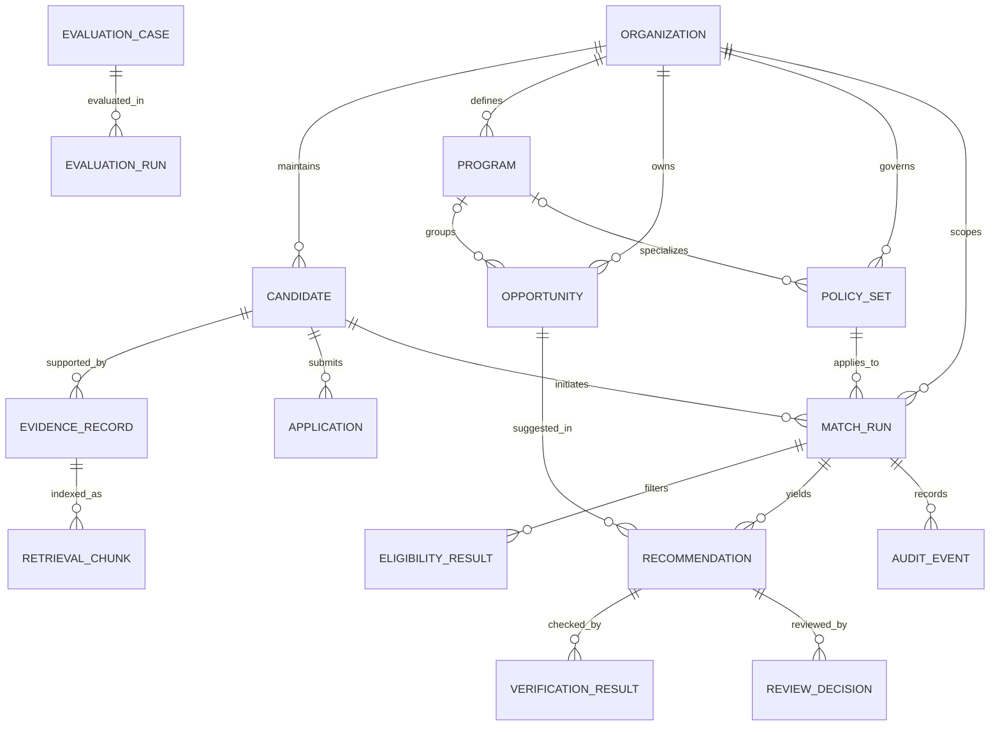
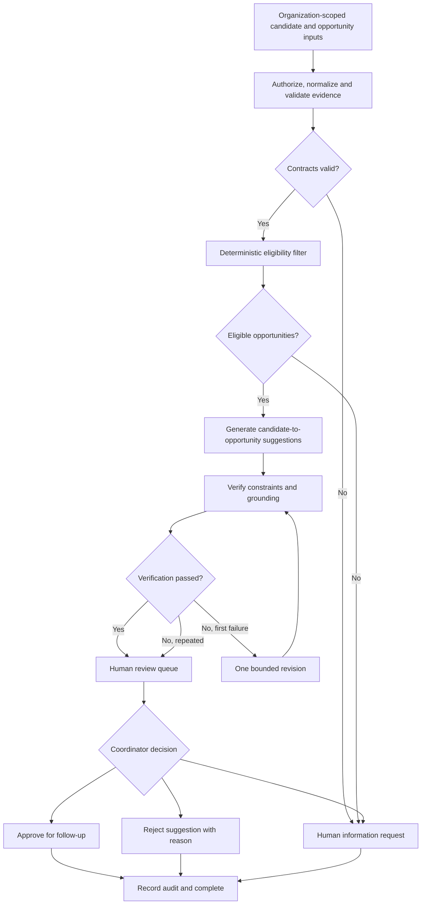
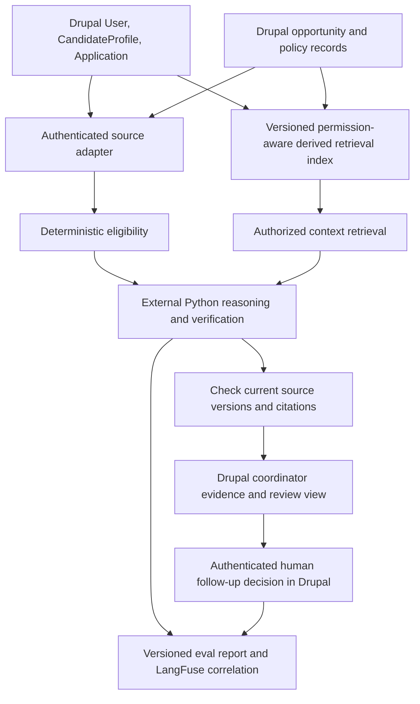

# Recruitment Augmentation Platform — Project Foundation

**Document ID:** RAP-FOUNDATION-001  
**Version:** 0.3.1 (editorial redaction 2026-10-29; requirements unchanged)  
**Date:** 2026-10-12  
**Status:** DISCOVERY — D-001, D-002 and D-003 accepted; detailed requirements, models and technical implementations remain proposals until reviewed  
**Proposed repository:** `recruitment-augmentation-platform` (name to confirm)  
**Owner:** Damien House  
**Project category:** Applied AI & Workflow Systems / Product & Platform Architecture  
**Intended use:** GitHub repository bootstrap; requirements discovery; model development; architecture and implementation planning  
**Development framework:** Undecided (existing spec-driven framework, bespoke R&D method, or hybrid)

> **Reading rule.** Every item is either **[SOURCE]** (generalized from private prior design notes; see §2), **[PROPOSAL]** (design recommendation for a new independent implementation), **[OPEN]** (unresolved), or **[DECISION]** (approved by project owner). Nothing in this draft should be read as proof that the new platform has already been built. **D-001, D-002 and D-003 are approved architecture/scope directions; implementation details, models, additional proposed features and deployment choices remain subject to review.**

## 1. Project thesis

### 1.1 Product vision [DECISION — D-001]

Develop a **general-purpose recruitment augmentation architecture** for organizations that assess candidates against opportunities. The first concrete implementation is **nonprofit internship placement**. The same core should later support jobs, fellowships, apprenticeships, and other authorized placement scenarios *without rewriting its domain and control model*.

**Product principle:** generalized **architecture**, narrow **pilot delivery**. This is not a commitment to build all recruitment use cases in the MVP, nor a claim that multi-tenant SaaS already exists.

### 1.2 Problem statement [PROPOSAL]

Recruitment and placement teams must consolidate evidence from candidate applications, published opportunities, and organization-specific eligibility policies before deciding what deserves human follow-up. Repetitive comparison work creates friction; ambiguous inputs invite unsupported conclusions. A useful system should help reviewers identify plausible options, see the underlying evidence, recognize missing information, and exercise accountable judgment.

### 1.3 Product definition [PROPOSAL]

A human-supervised platform that:

1. Accepts authorized candidate and opportunity records in a **shared, configurable domain model**.
2. Uses **organization- and program-specific, versioned policies** for deterministic eligibility checks.
3. Produces reviewable candidate-to-opportunity suggestions backed by attributable evidence.
4. Verifies model outputs, captures unresolved uncertainty, and escalates safely.
5. Retains a human-controlled review and follow-up path and a traceable history of decisions.
6. Uses **Drupal as the authoritative reference application** for the integrated nonprofit pilot, while keeping core recruitment contracts independent of Drupal entity IDs (**D-002**).
7. Supports authorized, source-revision-aware retrieval of unstructured Drupal content and an **AI experience inside Drupal** backed by external controlled Python services (**D-002**).
8. Uses **versioned synthetic datasets, measured evaluation and explicit promotion gates** to control prompt/model/retrieval/agent changes (**D-003**).

The platform **assists** recommendation and review; it does not independently hire, reject, admit, rank people for hidden disposition, or commit placement decisions.

### 1.4 Approved scope strategy [DECISION — D-001]

| Layer | Definition | First release treatment |
|---|---|---|
| **Core platform** | Candidate, organization, opportunity, policy, evidence, recommendation, verification, review, audit, and evaluation contracts | Design and test these as reusable components |
| **First pilot** | A nonprofit program coordinator reviewing potential internship matches | Build **one** end-to-end workflow using synthetic internship/program fixtures |
| **Pilot configuration** | Internship-specific terms, eligibility constraints, program metadata, and sample review procedures | Express as policies, configuration, seed data, and adapters—not scattered platform special cases |
| **Future use cases** | Employer recruiting, full-time jobs, fellowships, apprenticeships, multiple programs, ATS integration | Compatibility targets; **no implementation commitment** in first release |
| **Future deployment** | Multi-organization operation and potentially multi-tenant SaaS | Plan organization scoping in contracts; do not promise production tenant isolation until tested |
| **Authoritative reference** | Drupal users/profiles/applications, opportunities, policy, review decisions via controlled adapter (**D-002**) | Required for integrated pilot; not required to make offline Slice 0 executable |
| **AI integration** | In-Drupal reviewer evidence view and external Python workflow backed by scoped Drupal/RAG inputs (**D-002**) | Required demonstration; module/retrieval provider choice remains open |
| **Evaluation** | Versioned synthetic golden/held-out cases, safety gates, per-case regressions, trace linkage (**D-003**) | Seeded in Slice 0; expanded and measured across every subsequent slice |

### 1.5 Why build it? [PROPOSAL]

- Provide a useful and inspectable nonprofit internship-matching pilot.
- Demonstrate Staff-level AI engineering through code, testable contracts, versioned decisions, evaluation, observability, safe failure, and appropriate orchestration.
- Support **comparative experiments** on a shared benchmark: deterministic baseline, a constrained AI workflow, and a multi-agent candidate architecture.
- Create GitHub artifacts, a demo, and evidence suitable for an honest technical portfolio.
- Keep the product requirements independent of the spec-driven or personal R&D framework eventually chosen to build it.

## 2. Provenance and evidence boundaries

### 2.1 Source material [SOURCE — generalized]

*Editorial redaction 2026-10-29 (follow-up F2): references to private source files, former-client material and engagement details were removed from the current document. Earlier versions remain in Git history; this redaction does not remove historical copies.*

- Private prior design notes and discussions about a human-supervised candidate-placement workflow informed the problem framing. They are **not held in this repository**, are **not product requirements**, and are **not evidence of any implementation**.
- Owner career and portfolio-positioning notes informed project goals and publication guardrails only; they are not product requirements.
- `dhouse109/agentic-harness-lab` — separate R&D project that may yield reusable test/evidence patterns, subject to independent review of its current code.
- `docs/architecture/drupal-rag-evaluation-proposal-v0.1.md` — architecture proposal accepted **in direction** via D-002 and D-003; the proposal remains historical, and the accepted ADRs govern decisions.

### 2.2 Proposed reference workflow [PROPOSAL]

This project proposes the following independent reference workflow. It is a design proposal for this platform, not a description of any prior system, and remains subject to the accepted ADRs:

1. A **Profile** AI role normalizes candidate/application information.
2. A **deterministic eligibility** stage filters out opportunities that fail hard program requirements.
3. A **Placement** AI role reasons over the eligible subset and proposes matches.
4. A **Verification** AI role checks evidence and quality.
5. At most **one correction attempt** precedes escalation to a human.
6. **Human review** precedes any consequential decision.
7. **Pydantic** for structured boundaries; **LangGraph** for reasoning flow; **Temporal** for durable workflow lifecycle; **LangFuse** for observability; **Drupal** as the authoritative application/data context (**D-002**). These remain intended demonstration technologies, not locked choices.
8. Retrieval over unstructured documents is in scope (**D-002**); implementation details and infrastructure remain open.
9. Evaluation is designed in from the start rather than added ad hoc (**D-003**).

### 2.3 Approved new directions (not historical implementation claims) [DECISION — D-002, D-003]

- **D-002:** Drupal is the pilot's authoritative application, with candidate account/profile/application distinction, controlled adapters, derived authorization-filtered RAG, version/freshness checks, and an in-Drupal AI review surface. Core contracts remain portable.
- **D-003:** Evaluation is foundational, with curated labeled synthetic cases, per-case regressions, human adjudication, safety-blocking promotion gates and intended LangFuse observability correlation. This is a future implementation plan, not a statement about any prior system.

### 2.4 Clean-room rule [PROPOSAL]

Build a new independent reference implementation. Reuse general engineering principles and publicly usable code only where rights are clear. Do not transfer actual candidate records, client configurations, private prompts, credentials, HR policies, or any other proprietary third-party materials into this repository. Initial data must be synthetic or explicitly licensed.

## 3. Personas and user journeys [PROPOSAL]

### 3.1 Core platform actors

| Actor | Generalized responsibility | Nonprofit internship pilot mapping |
|---|---|---|
| **Reviewer** | Initiate/inspect match runs, validate evidence, record recommendation disposition | Program coordinator |
| **Organization administrator** | Manage authorized staff access, opportunity sources, and policy configuration | Nonprofit program administrator |
| **Opportunity owner** | Provide/update details about open opportunities | Internship program or host liaison (seed-data only in MVP) |
| **Candidate** | Person whose authorized data is evaluated; rights and consent/notice handling must be resolved before live use | Internship applicant (represented solely by synthetic data) |
| **System operator** | Diagnose runs and support evaluation without indiscriminate access to personal details | Developer/operator for the local pilot |

A reviewer may approve a **suggestion for human follow-up**, not a hiring or placement decision. The candidate-facing portal, employer self-service, and unrestricted data sharing are out of scope for the first release.

### 3.2 First pilot user journey

**Program coordinator** selects one synthetic internship applicant → the platform validates the permitted profile and associated evidence → applies the nonprofit program's deterministic internship criteria → creates reviewable recommendations only for eligible internships → independently verifies claims and citations → presents recommendations and unknowns → coordinator approves for follow-up, rejects the *suggestion*, or requests information → the system records an auditable outcome.

### 3.3 Architecture portability scenario

As a **future contract test**, swap the internship fixture and program policy for a fictional employer with job openings. Core entity contracts, eligibility execution, evidence tracking, recommendation/review semantics, and audit events should remain unchanged. **A second production workflow/UI/integration is not required for MVP completion.**

## 4. Scope and non-goals

### 4.1 Platform capabilities specified in MVP [PROPOSAL]

- Stable, organization-scoped domain contracts for candidate, opportunity, eligibility policy, evidence, recommendation, review, and audit.
- Configurable opportunity category and optional program association; **internship is an initial configuration, not the core type name**.
- Versioned eligibility-rule interface, enforced by deterministic code.
- One candidate-to-opportunity run at a time; one active pilot organization and its synthetic fixtures.
- Explicit authorization/organization context propagated through input loading, eligibility, recommendations, reviews, and traces.
- Proof-bearing suggestions with clearly identified unknowns and a bounded error/repair path.
- A minimal human review interface or CLI workflow that cannot finalize placement autonomously.
- Reproducible deterministic baseline and a small evaluation suite.
- Integrated pilot must use **authoritative Drupal entity/revision-backed candidate, application, opportunity, policy and review data** through controlled interfaces (**D-002**).
- Integrated pilot must demonstrate **permission-aware RAG over permitted unstructured Drupal material**, a reviewer-facing evidence/AI surface **inside Drupal**, and controlled external Python analysis (**D-002**).
- Evaluation starts with golden synthetic fixtures in Slice 0; extend to held-out cases and **prompt/model/retrieval/agent promotion gates** once inference is added (**D-003**).

### 4.2 Nonprofit internship pilot [PROPOSAL]

- Synthetic applicants, nonprofit programs, internship opportunities, and evidence references.
- Internship-specific policy examples (e.g., eligibility for a given program, schedule availability, required skills when applicable) expressed as a **versioned policy fixture**, not baked into domain classes.
- Coordinator review with **approve-for-follow-up / reject-suggestion / request-information** dispositions.
- Positive, negative, ambiguous, and permission-denied evaluation cases.
- An architectural portability test using non-internship opportunities once core models stabilize.

### 4.3 Deferred [PROPOSAL]

- Any integration with **real clients or existing private HR systems**, external ATS, HR or workflow-automation tools, production messaging or managed production hosting. **Drupal itself is no longer deferred:** a local/synthetic Drupal reference integration is required by D-002.
- Real applicant or employee records, resumes, demographic data, contact details, and production credentials.
- Multi-tenant SaaS operation, cross-organization candidate sharing, external candidate portal, full ATS/recruiter CRM functionality, large-scale catalog synchronization, production notifications, or employer onboarding.
- Autonomous hiring, admissions, rejection, placement, or automatic candidate disposition.
- Universal "match scores," hidden aggregate ranking, or use of protected/proxy attributes to infer suitability.
- Production-scale document ingestion or RAG across live personal records, fine-tuning, persistent autonomous agents, or unbounded multi-agent coordination. **A narrowly scoped synthetic Drupal RAG proof is required** by D-002; implementation scale and exact backend remain open.

### 4.4 Architectural boundary [DECISION — D-001]

Do **not** create `InternshipCandidate`, `InternshipRecommendation`, or a fixed `nonprofit` branch in core workflow logic. Core models use generalized names such as `Candidate`, `Opportunity`, and `Recommendation`; pilot-specific meaning belongs to typed extensions, policy configuration, seed fixtures, and review presentation.

## 5. Functional requirements — baseline backlog [PROPOSAL]

Each requirement has a stable identifier to support issue/spec/test traceability.

| ID | Priority | Requirement | Example acceptance evidence |
|---|---|---|---|
| FR-001 | Must | Load organization-scoped fixtures of candidates, opportunities, policies, and evidence through a documented adapter | Given valid fixture, import succeeds reproducibly; malformed records produce actionable errors |
| FR-002 | Must | Normalize permitted candidate information and distinguish stated fact, sourced inference, and unknown | Every generated profile claim points to evidence or is marked unknown |
| FR-003 | Must | Validate organization, profile, opportunity, and policy objects against versioned contracts | Invalid data fails closed before matching |
| FR-004 | Must | Enforce organization/program-specific hard eligibility rules in deterministic code with recorded rule version | Clearly ineligible opportunity is excluded; rejection includes rule and reason |
| FR-005 | Must | Generate candidate-to-opportunity suggestions only from the eligible set | No ineligible opportunity appears as an approved recommendation |
| FR-006 | Must | Explain every recommendation using authorized, attributable evidence and identify uncertainty | Coordinator can inspect underlying evidence and missing information |
| FR-007 | Must | Independently verify schema, hard constraints, provenance, unsupported inferences, and explanation quality | Injected hallucination or policy conflict is flagged |
| FR-008 | Must | Bound revision and route unresolved cases to human review | A repeat verification failure never causes an infinite retry loop |
| FR-009 | Must | Allow an authorized human to approve a suggestion **for follow-up**, reject the suggestion, or request more information | Decision records reviewer, time, rationale, and recommendation version |
| FR-010 | Must | Preserve run, result, policy, prompt/model, review, and audit identities | Reviewer can reproduce the chain of evidence and decisions |
| FR-011 | Must | Support a deterministic no-LLM baseline for comparison | Same fixture produces a reproducible baseline output |
| FR-012 | Must | Provide an offline evaluation harness with labeled synthetic cases | Evaluation reports quality, violations, failure classes, latency, and estimated model cost when available |
| FR-013 | Should | Support re-running failed inference steps without duplicating review records or side effects | Simulated timeout/retry produces one logical review item |
| FR-014 | Should | Permit swapping model providers and workflow implementations behind explicit interfaces | A second implementation passes shared contract tests |
| FR-015 | Must — integrated pilot | Retrieve authorized unstructured Drupal evidence through a derived RAG projection | Retrieval enforces scope; response cites current source entity/revision |
| FR-016 | Must — integrated pilot | Integrate **Drupal** as authoritative reference through authenticated least-privilege adapters; other ATS adapters are future options | Drupal record/revision maps to core contract; forbidden writes denied |
| FR-017 | Must | Use generalized candidate/opportunity/review contracts without internship-only core entities | Same contract validates synthetic internship and fictional job examples |
| FR-018 | Must | Explicitly scope all records and runs to an organization context and reject cross-organization references | Cross-organization fixture and review attempts fail closed |
| FR-019 | Must | Support configurable opportunity categories and optional programs | Internship is represented as `opportunity_type=internship`, not a separate core workflow |
| FR-020 | Must | Resolve versioned eligibility rules from the active organization/program configuration | Changing a fixture policy produces a separately traceable policy result |
| FR-021 | Should | Provide a portability contract test with one synthetic non-internship scenario | Job example passes core validation/eligibility/review contracts without core code changes |
| FR-022 | Must — integrated pilot | Resolve Drupal User, versioned CandidateProfile and Application as distinct reference-data concepts | Drupal synthetic account/profile/application maps to portable contracts with entity/revision pointers |
| FR-023 | Must — integrated pilot | Resolve opportunities, programs, applicable policy versions, and authorized reviewer dispositions from Drupal | Reviewed result records source entity IDs/revisions and policy version |
| FR-024 | Must — integrated pilot | Index and retrieve only authorized unstructured content as a *derived* RAG projection | Each chunk retains source revision, scope and provenance; unauthorized access is denied |
| FR-025 | Must — integrated pilot | Invalidate/rebuild retrieval records and disallow stale recommendations after a source edit or withdrawal | Editing/withdrawing synthetic profile or text blocks its obsolete evidence |
| FR-026 | Must — integrated pilot | Show AI-assisted evidence interpretation **inside Drupal** with verified facts/unknowns distinguished and correctable by reviewer | Reviewer sees explanation, source, uncertainty and can reject incorrect interpretation |
| FR-027 | Must — integrated pilot | Run controlled external Python reasoning/verification via Drupal API contracts | Agent service has no unrestricted Drupal write authority |
| FR-028 | Must — evaluation foundation | Version synthetic golden/held-out cases and run configurations | Tests pin fixtures, policy, prompt/model/retriever and code versions or document variance |
| FR-029 | Must — AI evaluation slice | Report case-level quality, permission/policy safety, retrieval freshness, latency, retries and available model cost | Versioned baseline/candidate comparison records individual regressions |
| FR-030 | Must — AI evaluation slice | Reject prompt/model/retriever/agent changes that fail blocking safeguards | Known policy violation, unauthorized retrieval, stale evidence or critical fabricated claim blocks promotion |
| FR-031 | Must — observed integration | Link Drupal entity/revision, run/recommendation, agent trace/evaluation, and Temporal ID where applicable | Synthetic review trace reconstructs evidence without private candidate data |

### 5.1 Critical invariants [PROPOSAL]

1. A model **never** overrides deterministic eligibility or authorization decisions.
2. A model's unsupported assertion **never** silently becomes a candidate fact.
3. An eligible opportunity is a candidate for consideration, **not** a determination that a person should be hired or placed.
4. Consequential decisions require a genuine authorized human action.
5. A retry cannot produce duplicate review actions or downstream business side effects.
6. Historical review/audit records are append-only or otherwise tamper-evident.
7. Protected characteristics and irrelevant demographic/proxy signals are not used as model inputs, eligibility criteria, or recommendation rationales; job-related criteria and legal constraints must be independently reviewed before any real-world deployment.
8. Test data is synthetic by default and telemetry is redacted by default.
9. Every business record and workflow carries an explicit organization context; no cross-organization access or recommendation is allowed.
10. Pilot-specific policy must not be hard-coded into generalized entities, workflows, or matching interfaces.
11. The retrieval index is a **derived projection**, never a business-record authority; its content must remain scope-filtered and current.
12. AI interpretations do not automatically overwrite Drupal-authoritative profile/application facts.
13. An experiment fails promotion if it violates permission, hard eligibility, source-freshness or serious evidence/claim constraints, even when aggregate quality improves.

## 6. Nonfunctional requirements [PROPOSAL]

| ID | Area | Baseline requirement |
|---|---|---|
| NFR-001 | Privacy | Data minimization; no real applicant PII in public fixtures, prompts, traces, issues, or demos |
| NFR-002 | Security | Authenticated access for reviewer operations; least-privilege tool calls; server-side secrets; no model-authorized business writes |
| NFR-003 | Fairness and accountability | Assess unsupported claims, disparate error patterns, accessibility, and treatment of missing information; no automated employment decisions |
| NFR-004 | Reliability | Explicit failure classification; bounded retries; replay-safe/idempotent writes where required |
| NFR-005 | Traceability | Correlatable run, recommendation, evidence, policy, model/prompt, verification, and review identifiers |
| NFR-006 | Testability | Unit tests for rules/contracts; integration tests with mock model; adversarial/failure fixtures; reproducible offline evaluation |
| NFR-007 | Observability | Capture step outcome, error category, latency, token use, and cost when available; protect sensitive content |
| NFR-008 | Maintainability | Clean interfaces between domain/application data, inference, eligibility, reviewer, persistence, and workflow engine |
| NFR-009 | Cost discipline | Set a per-run token/cost budget and enforce bounded revisions before enabling real model calls |
| NFR-010 | Accessibility | Review interfaces should be keyboard usable and designed toward WCAG 2.2 AA where applicable |
| NFR-011 | Isolation readiness | Organization context is explicit, tested, and fail-closed, even though the MVP operates only one synthetic pilot organization |
| NFR-012 | Portability | Domain contracts, rules engine interface, recommendation lifecycle, and audit schema do not depend on an internship or Drupal implementation |
| NFR-013 | Retrieval integrity | Permission-check before context assembly, verify source revision/currentness before promoting suggestions, test delete/reindex/withdrawal |
| NFR-014 | Privacy and retention | Treat uploaded text as untrusted, minimize/redact observability payloads, define synthetic index cleanup and removal tests |
| NFR-015 | Experiment reproducibility | Pin fixture/policy/prompt/model/index/code versions; record stochastic variance where model output is not repeatable |
| NFR-016 | Evaluation safety | Zero-tolerance test gates for authorization breach, cross-org leakage, eligibility violation, stale evidence and critical unsupported claims |

**Measurement policy:** No baseline quality, latency, cost, accuracy, or fairness numbers are asserted yet. Define a labeled test set, capture baselines, then establish thresholds before promoting to real use.

## 7. Preliminary domain model [PROPOSAL]

### 7.1 Core entities and scoping

| Core entity | Primary fields (illustrative) | Boundary / relationships |
|---|---|---|
| `Organization` | `organization_id`, `name`, `status`, `configuration_version` | Owns policies and opportunity data; one synthetic organization in pilot |
| `Candidate` | `candidate_id`, `organization_id`, `profile_version`, `skills[]`, `interests[]`, `availability`, `unknowns[]` | Portable organization-scoped person representation; linked to Drupal account/profile by adapter, not by shared ID |
| `Application` | `application_id`, `candidate_id`, `organization_id`, `program_id?`, `source_ref`, `revision` | Specific participation/request; Drupal-backed in first integrated pilot |
| `SourceReference` | `source_system`, `source_entity_type`, `source_entity_id`, `revision_id`, `scope`, `updated_at` | Boundary to Drupal authority; evidence/recommendations can be checked for freshness |
| `Program` **(optional)** | `program_id`, `organization_id`, `name`, `program_type` | Groups opportunities/overrides; pilot uses an internship program |
| `Opportunity` | `opportunity_id`, `organization_id`, `program_id?`, `opportunity_type`, `title`, `requirements[]`, `location_mode`, `status`, `version` | General opportunity; internship, job, fellowship, etc. are configuration values |
| `EvidenceRecord` | `evidence_id`, `organization_id`, `subject_ref`, `source_ref`, `claim_type`, `excerpt_or_pointer`, `access_scope`, `captured_at` | Attributable support for profile attributes or recommendations |
| `PolicySet` | `policy_set_id`, `organization_id`, `program_id?`, `version`, `eligibility_rules[]`, `effective_at` | Applies explicit organization/program eligibility rules |
| `EligibilityResult` | `run_id`, `organization_id`, `candidate_id`, `opportunity_id`, `policy_version`, `decision`, `rule_outcomes[]` | Use `eligible`, `ineligible`, or `needs_information`; missing facts must not become inferred pass/fail |
| `MatchRun` | `run_id`, `organization_id`, `candidate_id`, `policy_version`, `status`, `attempt_count`, `started_at` | Owns candidate-specific evaluation/recommendation lifecycle |
| `Recommendation` | `recommendation_id`, `organization_id`, `run_id`, `opportunity_id`, `rationale`, `evidence_ids[]`, `unknowns[]`, `status`, `model_version?` | Suggestion for human review, never a completed placement |
| `VerificationResult` | `verification_id`, `organization_id`, `recommendation_id`, `outcome`, `issues[]`, `checks[]`, `version` | Verification is independent of human authorization |
| `ReviewDecision` | `decision_id`, `organization_id`, `recommendation_id`, `reviewer_id`, `decision`, `reason`, `decided_at` | Explicit human follow-up disposition and immutable history |
| `AuditEvent` | `event_id`, `organization_id`, `run_id?`, `actor`, `action`, `record_ref`, `timestamp`, `metadata` | Tamper-evident/append-only design; minimum necessary metadata |
| `RetrievalChunk` **(derived)** | `chunk_id`, `source_ref`, `organization_id`, `access_scope`, `index_version`, `text_pointer` | Permission-aware derived projection; can be invalidated/rebuilt; never source of truth |
| `EvaluationCase` | `case_id`, `fixture_version`, `policy_version`, `expected_outcomes`, `source_evidence_ids[]`, `rubric_version` | Synthetic labeled regression / held-out example |
| `EvaluationRun` | `eval_run_id`, `dataset_version`, `code_revision`, `config_versions`, `case_results[]`, `trace_refs[]` | Reproducible evidence about changes without exposing applicant PII |

**Important:** `organization_id` is a contract-level boundary from day one, **not evidence of operational multi-tenancy**. All reference resolution, authorizations, and evaluation fixtures must validate that records belong to the selected organization. Live tenancy/security requires independent design and testing before real data is used.

Consent/notice/legal basis, retention, correction, and deletion requirements remain **open for live data**. An illustrative `consent_status` flag alone would not settle those obligations.

**Drupal mapping rule (D-002):** A Drupal `User` is an identity/account, not the platform `Candidate` ID. A versioned Drupal profile and application map to `Candidate`, `Application`, `EvidenceRecord`, and `SourceReference` via a controlled adapter. Future ATS systems can implement the same contracts.

**Evaluation mapping rule (D-003):** `EvaluationCase` and `EvaluationRun` refer to synthetic fixtures plus results, never to an automatically learned hiring truth. The held-out dataset is evaluated without reusing its cases for prompt selection.

### 7.2 Relationships (conceptual, not storage schema)



### 7.3 Example recommendation contract (synthetic, not final schema)

```json
{
  "organization_id": "org_pilot_001",
  "recommendation_id": "rec_demo_001",
  "run_id": "run_demo_001",
  "candidate_id": "candidate_demo_001",
  "opportunity_id": "opportunity_demo_004",
  "opportunity_type": "internship",
  "rationale": "The synthetic candidate reports Python experience and an interest in data analysis, both relevant to the published internship responsibilities.",
  "evidence_ids": ["evidence_demo_003", "evidence_demo_008"],
  "unknowns": ["Weekly schedule availability is not confirmed"],
  "policy_version": "pilot_internship_policy_v1",
  "model_version": "mock-model-v1",
  "status": "pending_verification"
}
```

A non-internship recommendation changes the opportunity fixture/type and applicable policies—not the core recommendation contract. No numeric match score is included by default; introduce one only after an explicit rationale, calibration, fairness, and evaluation decision.

### 7.4 Source-of-truth, derived retrieval and evaluation [DECISION — D-002, D-003; data shapes proposed]

- **Authoritative Drupal:** User, candidate profile, application, program/opportunity/policy, staff review, revision history and access-control decisions. Exact Drupal content types and modules are open.
- **Derived retrieval:** scope/permission-filtered chunks with source/revision pointers; never use a stale index as authority or write inferred facts back automatically.
- **Portable contracts:** candidate, evidence, eligibility, recommendation and review objects use their own stable identities; Drupal-specific IDs appear only in adapter/source references.
- **Evaluation records:** labeled synthetic expected cases, pinned policy/source/prompt/retrieval configuration, model outcomes, human adjudication, per-case regression and trace correlation.

## 8. Workflow and state models [PROPOSAL]

### 8.1 Logical workflow



The diagram is a **logical model**, not a commitment that all steps require separate LLM agents. The first version should prove a deterministic baseline before introducing inference.

### 8.2 Candidate match-run state

Proposed statuses: `created`, `validating`, `eligibility_checked`, `generating`, `verifying`, `awaiting_review`, `information_required`, `completed`, `failed`, `cancelled`.

Proposed run invariants:

- Each transition is validated and emits an audit event within its organization context.
- A run cannot reach `completed` with an unreviewed consequential outcome.
- Error states preserve diagnostic information without storing unredacted sensitive content in telemetry.
- One `run_id` can own multiple suggestions; each suggestion has independent review history.

### 8.3 Execution/control model

```text
User / API / CLI
   -> Application service (authorization; business state)
       -> Load organization-scoped synthetic candidate/opportunity/policy data
       -> Run eligibility service (deterministic)
       -> Matching strategy (deterministic baseline OR bounded AI workflow)
           -> Profile interpretation [optional inference]
           -> Placement reasoning [optional inference]
           -> Verification [deterministic checks + optional inference]
       -> Persist immutable recommendation/review evidence
       -> Human review adapter
       -> Metrics / evaluation / audit adapters
```

### 8.4 Drupal ↔ external AI reference flow [DECISION — D-002; wiring proposed]



An initial no-LLM/offline contract slice is still permitted. Passing it alone **does not meet** D-002 integrated Drupal/RAG acceptance.

## 9. Preliminary agent model [PROPOSAL]

| Logical role | Inputs | Outputs | Must not do |
|---|---|---|---|
| Profile interpreter | Authorized, organization-scoped candidate evidence | Structured attributes + provenance + unknowns | Infer unsupported qualifications or protected characteristics |
| Eligibility evaluator (NOT an agent) | Profile + scoped opportunities + org/program policy version | Per-opportunity hard-rule results | Delegate policy compliance to an LLM |
| Placement reasoner | Verified profile + **eligible** organization-scoped opportunities + evidence | Structured, grounded opportunity suggestions | Select ineligible opportunities or make final decisions |
| Verifier | Recommendation + source evidence + rule outcomes | Typed pass/revise/escalate decision and issues | Approve a placement or silently rewrite historical evidence |
| Coordinator | Verified suggestions + evidence + unknowns | Explicit review decision | Delegate consequential authorization to model output |

**Design experiment:** compare (A) deterministic recommendation baseline, (B) minimal single-model path, and (C) Profile/Placement/Verification separation on the **same versioned dataset**. Choose the smallest design that meets quality, safety, and cost requirements; multi-agent is a hypothesis, not an obligation.

## 10. Evaluation model [PROPOSAL]

### 10.1 Required fixture classes

- Easy valid candidate-to-opportunity case.
- Hard eligibility exclusion despite attractive semantic fit.
- Candidate with incomplete availability and missing evidence.
- Ambiguous skill claim that must remain unknown.
- Conflicting application statements.
- Retrieval/evidence access forbidden by permissions.
- Generated explanation that cites non-existent evidence.
- Provider timeout and retry.
- Repeated verification failure leading to human escalation.
- Duplicate run or review submit testing idempotency.
- Accessibility/usability scenario for a coordinator with keyboard-only navigation (when UI exists).
- Candidate and opportunity refer to **different organizations**; the request must be rejected.
- Same general-purpose contracts run a fictional non-internship job opportunity fixture.
- A required eligibility fact is unknown; outcome must be `needs_information`, not invented eligibility.

### 10.2 Measures to capture

| Category | Example measures |
|---|---|
| Constraint correctness | Rate of ineligible opportunities emitted; unauthorized action attempts |
| Evidence/grounding | Unsupported claim rate; evidence pointer completeness; missing-information disclosure |
| Recommendation utility | Coordinator accept/reject/request-more-info distribution and qualitative reasons; no claim that approvals equal ground truth |
| Review safety | Percent of consequential outcomes with authorized human decision; escalation behavior |
| Reliability | Contract validation failures, retries, duplicate side-effect rate, recovery completion |
| Performance/cost | Per-run latency, tokens, model cost, number of inference calls, budget overruns |
| Equity review | Disparities in error patterns across lawful, appropriately designed test cohorts under expert review before real use |

For a true recruiting product, legal/privacy and employment-discrimination review are go-live prerequisites. A synthetic portfolio demo is not evidence that the system is safe to use in real hiring.

### 10.3 Evaluation evidence artifacts

- `evals/datasets/v0.2/` synthetic pilot cases and a portability case, with expected outcomes, eligibility reasons, and evidence.
- `evals/rubrics/` documented verification and reviewer rubrics.
- `evals/results/` reproducible run outputs, model/prompt/policy versions, and failures (redacted).
- `docs/evaluation/EVALUATION_PLAN.md` with baselines and release gates.

### 10.4 Required versioned evaluation and promotion process [DECISION — D-003; mechanics proposed]

1. Build a small **synthetic golden dataset** and separate **held-out cases** with expected eligibility results, evidence references, ambiguity and reviewer rubrics.
2. Use the same frozen cases to compare deterministic/no-LLM, single-model and Profile → Placement → Verification strategies; do not equate added agent complexity with improved quality.
3. Pin Drupal synthetic source revisions, policy, retrieval index, prompt, model/configuration, code revision and experiment/run IDs. Log model variance rather than promising identical model text.
4. Generate a **per-case regression report** and a quality/cost/latency comparison; let a person adjudicate subjective match usefulness. LLM-as-judge, if introduced, is supplemental.
5. Block promotion for eligibility-policy, permission/cross-org, stale-source or critical unsupported-claim errors even if average subjective quality improves.
6. Correlate run, recommendation, source revision and evaluation record with privacy-safe LangFuse trace IDs and Temporal workflow IDs when those integrations exist.

**First metric definitions to specify:** hard-eligibility violation rate, retrieval authorization/freshness failures, evidence precision, unsupported-claim frequency, unknown-handling errors, verification true/false alarms, reviewer corrections, time to disposition, latency (p50/p95), retries and cost per reviewed suggestion. Baselines are **not yet measured**, and non-safety release thresholds are **not approved**.

## 11. Architecture decision register

| ADR | Decision | Status | Boundary |
|---|---|---|---|
| **ADR-0001 / D-001** | General-purpose core, nonprofit internship pilot | **ACCEPTED** | Shared contracts independent of internship-specific workflow |
| **ADR-0002 / D-002** | Drupal authoritative first-pilot application + controlled RAG projection | **ACCEPTED** | Drupal first; core portable; exact index/modules open |
| **ADR-0003 / D-003** | Versioned synthetic evaluation + change-promotion safety gates | **ACCEPTED** | Start eval in Slice 0; measured AI comparisons later |

**Open decision questions (not pre-assigned ADR numbers):** `OPEN-ARCH-001` Drupal data/entity/module and review UI choices; `OPEN-ARCH-002` retrieval backend/index transport and permission mechanism; `OPEN-ARCH-003` LangGraph/LangChain/Temporal boundaries and SDK selection; `OPEN-ARCH-004` LangFuse deployment, trace retention and evaluation runner; `OPEN-ARCH-005` language/build infrastructure, deployment and local development tooling; `OPEN-PROCESS-001` spec-driven vs proprietary R&D delivery framework; `OPEN-PRODUCT-001` exact review surface and follow-up semantics; `OPEN-GOV-001` license; `OPEN-GOV-002` real-world privacy/fairness/retention review.

**Target demonstration stack (not all implementation choices ratified):** Drupal/Drupal AI ecosystem (approach open), Python typed contracts/Pydantic, LangGraph, LangChain where retrieval tooling helps, Temporal for justified long-lived workflows, and LangFuse for experiment/trace observation. Exact providers, versions, storage and hosting remain undecided.

**Decision provenance:** Project owner accepted D-001, then explicitly approved both P-002 → D-002 and P-003 → D-003 on 2026-10-12. Nothing here represents completed implementation or measured evaluation results.

## 12. Development-method independence [PROPOSAL]

A future spec-driven tool or custom R&D framework should be able to read stable project artifacts without redefining the domain:

- Unique functional IDs (`FR-*`) and nonfunctional IDs (`NFR-*`).
- Versioned domain contracts and examples.
- Each model/workflow change linked to an ADR.
- Every implemented feature linked to a test and observable acceptance result.
- Recorded assumptions, unanswered questions, and rejected alternatives.
- Explicit separation of *requirements*, *design*, *implementation*, *evaluation*, and *evidence*.
- No framework-generated file should become the only copy of a requirement or architectural decision.

Suggested work gates, adaptable to the chosen framework:

1. **Discovery gate:** ratify pilot reviewer, authorized data boundary, policy fixture examples, and MVP review outcomes. Product scope direction (ADR-0001) is already approved.
2. **Contract gate:** approve general-purpose organization-scoped domain schema, interface contracts, internship-policy plugin/fixture, and synthetic examples; prove a non-internship contract instance.
3. **Baseline gate:** complete deterministic, reviewable synthetic slice with initial golden assertions and a versioned baseline report.
4. **Drupal integration gate:** prove authoritative entity/revision mapping, authenticated reviewer flow, organization scope and no unrestricted writes.
5. **Retrieval gate:** index permitted unstructured Drupal text, refuse unauthorized/stale material, and show a source-grounded in-Drupal AI/evidence view.
6. **AI & evaluation gate:** compare single-model and multi-agent variants on the same synthetic golden/held-out cases; block safety regressions before prompt/model/retrieval promotion.
7. **Durability & observability gate:** inject failures; prove retry/idempotency/human-wait behavior as designed, plus trace/eval correlation with privacy safeguards.
8. **Portfolio gate:** publish demo, diagrams, tests, limitations, measured evaluation results and clearly labeled implementation status.

## 13. Suggested GitHub repository structure [PROPOSAL]

```text
recruitment-augmentation-platform/
├── README.md
├── LICENSE                                # only after owner chooses one
├── AGENTS.md                              # optional coding-agent guidance
├── docs/
│   ├── PROJECT_FOUNDATION.md
│   ├── assumptions-and-open-questions.md
│   ├── requirements/
│   │   ├── functional.md
│   │   └── nonfunctional.md
│   ├── decisions/
│   │   ├── ADR-0001-general-platform-nonprofit-pilot.md
│   │   ├── ADR-0002-drupal-authoritative-reference-and-rag-boundaries.md
│   │   └── ADR-0003-versioned-agent-evaluation-and-prompt-promotion.md
│   ├── models/
│   │   ├── domain.md
│   │   ├── drupal-domain-mapping.md
│   │   └── contracts.md
│   ├── architecture/
│   │   ├── system-context.md
│   │   ├── retrieval-security-and-freshness.md
│   │   └── drupal-rag-evaluation-proposal-v0.1.md  # historical proposal
│   ├── evaluation/
│   │   ├── metric-definitions-and-synthetic-gold-set.md
│   │   └── prompt-change-promotion.md
│   ├── pilots/
│   │   └── nonprofit-internship-placement.md
│   └── roadmap.md
├── src/                                     # chosen after contract/design review
├── drupal/                                  # adapter and demo only after tech decision
├── tests/
├── evals/
│   ├── datasets/                            # synthetic golden and held-out
│   ├── rubrics/
│   └── results/
└── examples/
    └── synthetic-data/
```

**Bootstrap order:** Commit Foundation + three accepted ADRs + pilot requirements first. Then define portable contracts and an offline baseline; add Drupal adapter, scoped retrieval, AI workflow, Temporal and LangFuse incrementally with evaluation evidence. Do not scaffold multiple services merely to satisfy a framework list.

## 14. First implementation slices and definition of done [PROPOSAL]

**Slice 0 — Contract and deterministic baseline.** Given synthetic organization, candidate, opportunity, and policy fixtures, run authorization, typed validation, deterministic eligibility and an auditable approve-for-follow-up suggestion. Seed versioned golden and held-out evaluation cases; no paid LLM, Drupal runtime or external vendor is necessary **for this slice only**. Exit: reproducible commands; contracts and negative tests; zero known policy/cross-org failures; baseline report; non-internship portability example.

**Slice 1 — Drupal authoritative reference.** Create synthetic account/profile/application/program/opportunity/policy/reviewer fixtures in Drupal and a controlled contract adapter. Exit: mappings identify source entities/revisions, scope tests fail closed, and an authorized staff review is stored in Drupal.

**Slice 2 — Authorized retrieval and inside-Drupal evidence.** Create a derived permission-aware index from synthetic unstructured Drupal content and an evidence-assisted reviewer surface inside Drupal. Exit: citations resolve to current allowed revisions; role/cross-org, update, withdrawal and injected-prompt tests are demonstrated.

**Slice 3 — External inference with measured comparison.** Implement controlled Python Profile → eligibility → Placement → Verification behavior; use Pydantic typed boundaries, LangChain retrievers if justified, and LangGraph for explicit agent state. Compare with the deterministic and constrained single-model baselines. Exit: grounded recommendation, bounded failure/escalation and versioned per-case evaluation reports; safety regressions block promotion.

**Slice 4 — Durable, observable execution.** Integrate Temporal lifecycle with nondeterministic inference behind Activity boundaries where needed, and LangFuse trace/experiment correlation. Exit: pause/restart/retry/idempotency tests, human-review wait and trace-to-Drupal-reference demonstration with redacted/synthetic telemetry.

**Slice 5 — Quality-improvement evidence and portfolio.** Complete golden/held-out comparisons; document prompt/model/retrieval change decisions, measured quality/failure/latency/cost effects, limitations, and a reproducible demo. This slice completes the showcase; **evaluation begins in Slice 0**.

**Do not claim** a completed MVP just because Slice 0 works. The approved showcase requires Drupal source of truth, RAG, in-Drupal AI evidence, external reasoning, and continuous-evaluation integration, with safety boundaries validated.

## 15. Open questions for the owner (ranked)

**Resolved architecture:** D-001 — general-purpose core and nonprofit pilot; D-002 — Drupal source of truth, derived secure RAG and inside/outside Drupal showcase; D-003 — versioned evaluation and promotion gates.

**Next product confirmations:**

1. Is the first reviewer a nonprofit **program coordinator** (still a proposed persona)?
2. Does review **approve for follow-up only** (strongly recommended, not a final internship placement)?
3. Which fictional pilot policy examples and application questions should appear in the synthetic dataset?
4. Should the future GitHub repo be public, initially private, or staged public only after audit?

**Implementation choices still open:** exact Drupal entities/modules, Drupal AI module vs Drupal UI/external service implementation, retrieval backend, Python/web/deployment stack, model vendor, LangChain/LangGraph use boundaries, Temporal/worker topology, LangFuse installation and evaluation runner, repository license, and spec-driven development method. Do not reinterpret acceptance of D-002/D-003 as adoption of these unreviewed choices.

## 16. Next actions [PROPOSAL]

1. Commit Foundation v0.3 and **ADR-0001/0002/0003** as the three accepted product/architecture directions (once a GitHub repo is created).
2. Update the nonprofit pilot spec to include Drupal User/Profile/Application source mapping, derived RAG checks, in-Drupal reviewer evidence and evaluation cases.
3. Model `SourceReference`/Drupal entity revisions, portable `Candidate` + `Application`, versioned index evidence, and `EvaluationCase`/`EvaluationRun` contracts.
4. Build synthetic **golden + held-out** data including missing facts, conflicting evidence, unauthorized retrieval, source revisions/withdrawals, prompt injection, and human review outcomes.
5. Define metric formulas and evaluation release-gate reporting **before** paid model runs; calculate actual baselines later, never invent targets/results.
6. Build the no-LLM offline baseline, then integrate Drupal, retrieval, external AI, durable execution and LangFuse in that order subject to architecture decisions.
7. Select the software/spec-driven development methodology after baseline contracts and quality gates are reviewed; preserve framework-independent requirements and evidence.

### 16.1 Immediate next artifacts

- `docs/models/drupal-domain-mapping.md`: Drupal User/Profile/Application/Opportunity/Policy/Review ↔ portable domain contracts, identity and source revisions.
- `docs/architecture/retrieval-security-and-freshness.md`: permission filtering, indexing invalidation and source freshness contracts.
- `docs/evaluation/metric-definitions-and-synthetic-gold-set.md`: dataset design, metric formulas, blocking failures, comparison report schema.

Do **not** start live applicant data processing or public-client data ingestion. Implement only fictional/synthetic records until dedicated governance work exists.

## Appendix A — Material to add if available

Most useful optional inputs from previous chats, local files, or repositories:

- Original conceptual system diagrams, sample candidate/opportunity records, or run traces that are **safe to reuse**.
- Generalized, owner-reviewed design notes that contain no private or third-party material.
- Existing specifications for a personal R&D or spec-driven software framework.
- A minimal description of the intended first user and end-to-end scenario.
- Any relevant reusable public harness-test code, ADR templates, or evaluation fixtures from `agentic-harness-lab`.

**Not needed now:** employer correspondence, private candidate records, proprietary third-party datasets, exact production credentials/configuration, or a final technology stack.

## Appendix B — Document change log

| Version | Date | Notes |
|---|---|---|
| 0.1.0 | 2026-10-12 | Initial proposed requirements, models, control boundaries, ADR register, and framework-neutral repo blueprint |
| **0.2.0** | **2026-10-12** | **Accepted D-001: general-purpose architecture with nonprofit internship pilot; revised scope, organization-scoped domain contracts, portability/eligibility requirements, ADR register, and first-slice criteria** |
| **0.3.0** | **2026-10-12** | **Accepted D-002 Drupal authoritative reference plus secure derived RAG and D-003 versioned evaluation/prompt promotion; expanded FR-022–031, NFR-013–016, domain and execution boundaries, staged integrated-pilot gates and repo scaffold** |
| 0.3.1 | 2026-10-29 | Editorial redaction (F2): generalized source provenance (§2.1); recast §2.2 as an independent proposed reference workflow; removed former-client names, private tool references, private source-file names, third-party attributions and engagement details. No requirement or decision changed. Earlier versions remain in Git history |