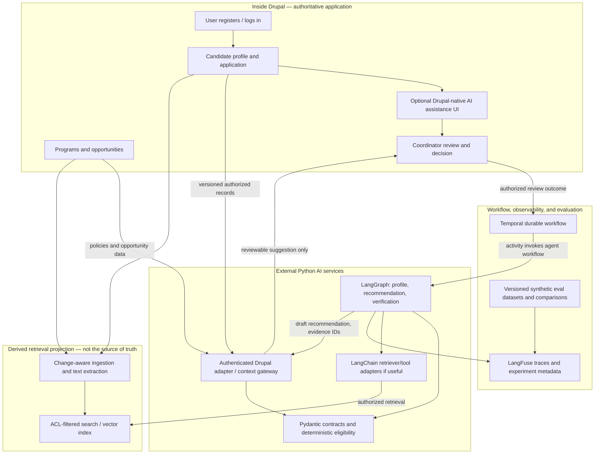
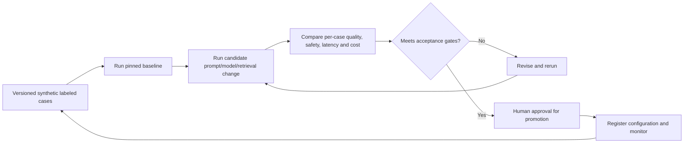

# Recruitment Augmentation Platform — Drupal RAG & Evaluation Architecture Proposal

**Document ID:** RAP-ARCH-PROPOSAL-001  
**Version:** 0.1.1 (editorial redaction 2026-10-29; architecture content unchanged)  
**Date:** 2026-10-12  
**Status:** PROPOSAL — not an accepted ADR. P-002 and P-003 were later accepted **in direction** as D-002 ([ADR-0002](../decisions/ADR-0002-drupal-authoritative-reference-and-rag-boundaries.md)) and D-003 ([ADR-0003](../decisions/ADR-0003-versioned-agent-evaluation-and-prompt-promotion.md)); those ADRs govern. Everything else here remains a proposal.  
**Parent:** `recruitment-augmentation-platform-project-foundation-v0.2.md`  
**Pilot:** Fictional nonprofit internship placement, synthetic records only

> **Source/evidence discipline.** `[PROPOSED]` means a new system design for this project; `[OPEN]` means a decision not yet made. Earlier private discussions informed the problem framing only (see §2) and do not establish a specific retrieval stack, embedding provider, Drupal modules or evaluation implementation. This GitHub project is an independent reference implementation and makes no claim about reproducing any private or client system.

## 1. Why this proposal exists

The project owner wants to showcase applied AI **inside and outside Drupal** around a Drupal source of truth, retrieval-grounded candidate evaluation, specialized agent responsibilities, and the LangGraph/LangChain, Temporal, Pydantic and LangFuse technologies under consideration. The project should also establish a systematic quality-improvement process, rather than stop at ad-hoc observation.

This proposal makes two specific architecture changes relative to Foundation v0.2:

- **P-002 — Drupal-first reference implementation [PROPOSED]:** Drupal is the authoritative application/data layer for the first pilot, with a controlled retrieval projection available to external AI services. The *core domain contracts* remain portable to other authoritative systems in later adapters.
- **P-003 — Evaluation as a first-class product capability [PROPOSED]:** A versioned regression dataset and reproducible offline evaluation harness exist before model-driven suggestions are promoted. LangFuse can correlate evaluations and traces, but observability tooling alone does not create ground truth.

Neither proposal changes the approved **D-001 general-purpose core plus nonprofit internship pilot** strategy. At the time of writing both required project-owner review. *Editorial note (2026-10-29): P-002 and P-003 were subsequently accepted in direction as D-002 ([ADR-0002](../decisions/ADR-0002-drupal-authoritative-reference-and-rag-boundaries.md)) and D-003 ([ADR-0003](../decisions/ADR-0003-versioned-agent-evaluation-and-prompt-promotion.md)); those ADRs govern this proposal.*

## 2. Provenance

*Editorial redaction 2026-10-29 (follow-up F2): this section previously summarized private prior design discussions. That material, including identifying attributions and dialogue, was removed from the current document under the project's source-hygiene rule. It remains in earlier Git history; this redaction does not remove historical copies.*

The proposal is an independent design. The only points carried forward from earlier private discussions are generalized engineering principles:

- Retrieval over candidate-submitted documents is a design consideration. Nothing here establishes a vector store, embedding model, Drupal Search API configuration, chunking approach, access-control implementation or pipeline placement, and none should be inferred.
- Observability should address performance, reliability and cost, not only tracing.
- Labeled, repeatable evaluation should exist before model-driven suggestions are promoted; ad-hoc review is not sufficient. This motivates P-003.

## 3. Separation of responsibilities [PROPOSED]

| Concern | Authority / implementation | Not its role |
|---|---|---|
| Candidate registration and login | Drupal user/account | Model-derived identity or ranking |
| Candidate profile and application | Drupal-backed profile/application entities with version history; optional attached documents | Agent-created 'facts' without source and review |
| Organization, programs, opportunities, access rules | Drupal authoritative entities/configuration for first pilot | Vector index as system of record |
| Human review and resulting business disposition | Authenticated Drupal staff workflow / authorized API | Model-triggered final placement or rejection |
| Retrieval over unstructured authorized text | Permission-filtered derived search/vector index with source pointers | Policy enforcement or unrestricted record access |
| Eligibility | Deterministic service/policy engine using authoritative fields | LLM guesses about required qualifications |
| Candidate interpretation, recommendation, verification | Controlled external Python inference service | Unrestricted writes into Drupal |
| Agent coordination | LangGraph (optional LangChain primitives for tools/retrievers) | Durable business orchestration alone |
| Workflow lifecycle | Temporal workflows with external/LLM calls behind activities | Nondeterministic model operations in replay-sensitive workflow code |
| Typed contracts | Pydantic at adapter, inference, and output boundaries | Proof that a claim is semantically true |
| Traces and AI experimental metadata | LangFuse, with PII redaction and correlation IDs | Source of truth for a candidate record |
| Dataset labels and review feedback | Versioned synthetic evaluation fixtures; authorized human feedback with access controls | Automatic objective truth from raw reviewer clicks |

**Important distinction:** **LangChain and LangGraph are not synonyms.** LangChain can provide loaders, retrievers, model/tool integrations; LangGraph can coordinate explicit agent state and transitions. Their inclusion should be justified independently. This proposal uses LangGraph as the candidate agent orchestrator; it remains an intended demonstration technology, not a locked choice (ADR-0004, open items).

## 4. Reference architecture — conceptual, not yet chosen implementation

The diagram represents **logical ownership**, not hosting topology, an exact Drupal module lineup, or concrete Temporal API wiring.

### Data-source design

1. A candidate joins a fictional nonprofit's Drupal portal and is represented by a Drupal **User** record. A separate versioned **CandidateProfile** represents recruitment facts. A separate **Application** links the candidate to a program/opportunity.
2. The Drupal adapter maps `user_id` and entity/revision IDs to portable `Candidate`, `EvidenceRecord`, `Opportunity`, `PolicySet`, and `ReviewDecision` contracts. **Do not embed Drupal user IDs as the universal platform candidate identity.**
3. Structured eligibility fields (program membership, explicitly entered weekly availability, published opportunity requirements, status) are loaded using authoritative structured APIs rather than inferred through vector similarity.
4. Unstructured text (application answers, consented statements, opportunity descriptions, uploaded documents) can be indexed as an **authorized derived projection**, each chunk retaining source entity ID, revision, evidence pointer, organization/program scope, permissions, index timestamp, and content version.
5. The external service retrieves only authorized, task-relevant content. Retrieval is filtered by permission **before model context is assembled**. A policy check and fresh source-version check prevent stale or forbidden material from being used.
6. AI-generated interpretation is a *proposed claim*, linked to source evidence and explicit uncertainty. It does not become an authoritative profile attribute unless an authorized person makes an appropriate write/review decision.
7. A person reviews suggestions in Drupal; the authorized API stores the decision. A model must not write final placements, admissions, rejections, or job offers.

### 'Inside Drupal' AI proof, without duplicating agency

An initial **in-Drupal** capability could display an **evidence-assisted profile summary** or a coordinator-facing explanation pane, sourced exclusively from Drupal entities and authorized text. This may invoke Drupal AI modules or a controlled service endpoint; selection is **[OPEN]**. It must clearly distinguish declared facts, AI-derived interpretations, missing data, and sources. The interface should provide a link back to the authoritative record.

The **outside Drupal** demonstration should execute the candidate-placement/verification flow in Python with auditable state, constrained tool calls, and bounded escalation. Showing both surfaces demonstrates integration and governance—not two competing systems of record.

## 5. Retrieval questions we must test [PROPOSED]

- **Authorization:** Can a candidate see only their own data while coordinators see only records within assigned programs? Are scope filters enforced server-side at every retrieval step, not merely through a prompt?
- **Version/freshness:** If a candidate corrects availability or withdraws a document, does the index become invalidated/rebuilt, and are stale-source recommendations blocked?
- **Evidence fidelity:** Does a recommendation cite exact source IDs/revisions and accurately distinguish statements, verified facts, and inference?
- **Prompt injection:** Do uploaded resumes or text fields attempt to override system instructions or expand tool permissions? Are these treated as untrusted data?
- **Missing data:** Can the model abstain rather than fabricate experience, eligibility, location availability, or other applicant attributes?
- **Retention:** Can the system delete/re-index candidate material, cancel pending runs, and minimize stored traces when required?
- **Portability:** Could the same Python domain contracts run against a different ATS adapter later?

### Index placement [OPEN]

**Option A:** Drupal-centric Search API / Drupal AI integration exposes controlled retrieval tools/APIs to Python.  
**Option B:** Drupal sends authorized, versioned indexing events to an independently hosted retriever/vector store queried by the Python service.  
**Option C:** Hybrid: Drupal native AI for staff UX and a shared external index for Python orchestration.

We should benchmark a **minimal adapter-first vertical slice** before choosing between these. Drupal remains authoritative under every option; the index remains a disposable/rebuildable copy.

## 6. Quality measurement: from ad hoc to repeatable [PROPOSED]

### The evaluation loop

Each experiment records: `dataset_version`, `case_id`, `organization_id`, `source_revision`, `policy_version`, `retrieval_config_version`, `prompt_version`, `model_id`, `temperature_or_sampling_config`, `code_commit`, `run_id`, `trace_id`, `reviewer_label`, and `evaluation_timestamp`. No real candidate PII enters public fixtures, prompts, shared trace examples, or repository reports.

### Concrete metric candidates

| Metric | What it answers | Measurement method | Initial gate philosophy |
|---|---|---|---|
| **Hard-policy violation rate** | Did AI ever recommend an ineligible opportunity? | Deterministic assertions over labeled policy fixtures | **Zero tolerance** in tests |
| **Schema/contract pass rate** | Did each component return parseable, valid data? | Pydantic validation by stage | Track and diagnose each failure |
| **Evidence citation precision** | Do cited passages actually support recommendation statements? | Human-reviewed evidence/claim pairs; false citation counts | Block unsupported claims; track by prompt/retriever version |
| **Unsupported-claim rate** | Did the system infer facts absent from source? | Labeled counterexamples and claim-level review | Improve relative to baseline; disallow serious fabrication |
| **Eligibility/unknown handling** | Are missing or ambiguous inputs escalated rather than guessed? | Unknown-state fixture tests | Must preserve unknown without manufactured pass/fail |
| **Verification detection / false alarm rate** | Did verification catch bad recommendations without rejecting every good one? | Seed deliberately flawed and valid recommendations; confusion matrix | Report precision/recall and error types |
| **Reviewer usefulness / correction rate** | Did reviewers find recommendations actionable and accurate? | Structured rubric and logged corrections (not raw click-through alone) | Compare to no-AI baseline; avoid unsupported 'accuracy' claims |
| **Reviewer time-to-disposition** | Is the workflow actually helping the program? | Timed synthetic tasks comparing manual and augmented review | Report median and distribution, do not assert improvement before measurement |
| **Retrieval permission violation rate** | Did any retrieved context exceed authorized scope? | Access-denied and cross-org adversarial cases | **Zero tolerance** |
| **Stale-source recommendation rate** | Were outdated Drupal revisions used? | Source version mismatch tests | Block/promote to refresh route, not a valid recommendation |
| **Latency p50/p95** | How long do end-to-end and each agent step take? | Traces and timing metrics under defined environment | Balance with quality and review experience |
| **Cost per reviewed recommendation** | How expensive is a useful result, including retries? | Token/provider usage and run accounting | Compare cost alongside quality; no fabricated target |
| **Escalation/retry frequency** | Are verification or retrieval errors causing loops or cost spikes? | Workflow outcome and retry counters | Bounded retries, human escalation |

Do not collapse these into one uncalibrated **'match score'**. Hiring/placement quality is partly subjective, and a seemingly high aggregate number can obscure unsafe or unfair behavior. For demographic fairness testing, establish legal/privacy safeguards and evaluate error patterns with appropriate separate governance rather than feeding protected traits into matching decisions.

### Experiment discipline

1. Curate a small **synthetic golden dataset** with expected hard-rule outputs, source spans, and reviewer rubrics; include success, ambiguity, stale data, prompt-injection, permission-denied, and conflicting-evidence examples.
2. Pin all relevant versions; first run **deterministic and no-LLM baselines**, then a constrained single-model implementation, and only then the multi-agent architecture. Measure added benefit, latency, and cost.
3. Vary one major factor per comparison whenever feasible: prompt template, model, retrieval top-k/chunking, verification rule, or graph routing—not all at once.
4. Evaluate on cases not used to tune the prompt; create a held-out set to avoid overfitting. Have humans adjudicate subjective quality labels; LLM-as-judge is supplemental and must itself be checked for agreement with human labels.
5. Store per-case regressions, not only aggregate means. Refuse promotion for authorization, hard-eligibility, unsupported-critical-claim, or infinite-loop failures even if average usefulness improves.
6. Where approved and data protections allow, use live reviewer **correction and escalation patterns** as signals for future controlled evaluations—not as automatic labels of correctness.
7. Register results in a versioned report and correlate LangFuse trace/span IDs with workflow/application run IDs. Use tests and review gates to approve prompt/retrieval/model changes.

## 7. Draft requirement amendments for Foundation v0.3 [NOT YET ACCEPTED]

The following are candidate requirements, to review before modifying the v0.2 baseline. Prior optional/deferred items `FR-015` (RAG) and `FR-016` (Drupal integration) would be reprioritized as **planned reference-implementation requirements**, not necessarily required in the very first offline contract slice.

| Proposed ID | Draft requirement | Testable acceptance |
|---|---|---|
| `FR-022` | Drupal User + CandidateProfile + Application entities serve as authoritative pilot profile sources via controlled adapter | Versioned synthetic candidate created/updated in Drupal maps to portable contract |
| `FR-023` | Drupal holds organization, opportunity, policy and authorized review records for reference pilot | Every reviewed run cites authoritative Drupal IDs/revisions |
| `FR-024` | Authorized RAG projection of candidate/application and opportunity unstructured text | Each chunk has provenance, revision, access scope; unauthorized retrieval denied |
| `FR-025` | Source corrections/withdrawals invalidate stale recommendations and index entries | Mutated/deleted source cannot yield a current valid recommendation |
| `FR-026` | In-Drupal AI-assisted evidence/summary review experience (choice of Drupal AI or service-powered UI open) | Reviewer sees source, AI vs verified fact, unknown status, and can reject incorrect interpretation |
| `FR-027` | External Python matching service integrates via least-privilege contracts | No AI path has unrestricted record-write authority |
| `FR-028` | Versioned repeatable evaluation cases and prompt/model/retriever configuration | Same pinned setup yields reproducible artifacts or documented controlled nondeterminism |
| `FR-029` | Quality, safety, retrieval, latency, and cost metric report for each experiment | Side-by-side baseline/change report with per-case regressions |
| `FR-030` | Evaluation promotion gate blocks safety regressions | Known policy/permission/fabrication failures cannot be waived by higher average scores |
| `FR-031` | Correlate Drupal source ID/revision, Temporal workflow, agent run, LangFuse trace, and eval result | Operator can trace a synthetic recommendation through these layers without exposing PII |

Proposed nonfunctional amendments: strict freshness checks, indexed-data deletion strategy, secure handling of applicant documents as untrusted inputs, and privacy-preserving observation/evaluation.

## 8. Suggested build order [PROPOSED]

| Slice | Scope | Evidence |
|---|---|---|
| **0 — Contract foundation** | Synthetic fixtures, general domain models, deterministic eligibility + reviewer outcomes, no LLM | Contract tests, rule tests, append-only review audit |
| **1 — Drupal authoritative reference** | Drupal User/Profile/Application/Opportunity/Policy fixtures; authenticated adapter; reviewer workflow | Drupal entity-to-contract tests, source revision and scope tests |
| **2 — Retrieval and 'inside Drupal' demo** | Index controlled unstructured content; authorization/freshness/evidence contract; staff-facing AI evidence panel | Retrieval benchmark, privacy/access tests, demo showing citations |
| **3 — Outside-Drupal inference** | Python model/retriever integration, typed Profile → Placement → Verification, bounded revision | Model output tests, grounded/unsupported claim examples |
| **4 — Durable and observable** | Temporal workflow/activity boundaries and human-review lifecycle; LangFuse traces/metadata | Restart/retry/idempotency tests and end-to-end trace correlation |
| **5 — Evaluation and comparison** | Formal golden + held-out datasets and reporting, compare deterministic/single-model/multi-agent solutions | Reproducible regression reports and prompt/model change decision |

**Evaluation infrastructure starts in Slice 0** with labeled fixtures and hard assertions and grows alongside implementation. Slice 5 denotes the finished comparative report, not the first time evaluation is considered.

## 9. What remains open

*Editorial note (2026-10-29): items 1 and 2 were answered when D-002 and D-003 were accepted in direction; they are kept as historical record. Items 3–5 remain open as recorded in the ADRs.*

1. Confirm **P-002:** Is Drupal a required first-pilot source of truth (my recommendation), while other ATS/CMS systems remain future adapters?
2. Confirm **P-003:** Is measurable evaluation/prompt-regression testing an explicit first-release showcase (my recommendation), with a quality gate before model changes?
3. Do you want the **in-Drupal** AI experience delivered using the Drupal AI module ecosystem, or is a native Drupal UI invoking the external service enough? A hybrid is also possible.
4. Decide retrieval implementation after an adapter/retrieval proof: Drupal Search API-based, external index, or hybrid.
5. Decide hosting/repo structure, libraries and spec-driven delivery framework only after contracts and acceptance criteria are reviewed.

## 10. Proposed next documents after acceptance

- `docs/decisions/ADR-0002-drupal-authoritative-reference-and-rag-boundaries.md`
- `docs/decisions/ADR-0003-versioned-agent-evaluation-and-prompt-promotion.md`
- `docs/models/drupal-domain-mapping.md`
- `docs/architecture/retrieval-security-and-freshness.md`
- `docs/evaluation/metric-definitions-and-synthetic-gold-set.md`
- Foundation `v0.3.0` incorporating reviewed requirement amendments.

## Change log

- **v0.1.0 — 2026-10-12:** Proposed source-of-truth, inside/outside Drupal, RAG boundaries and continuous evaluation architecture for review before updating the approved project baseline.
- **v0.1.1 — 2026-10-29:** Editorial redaction (F2). Replaced the private-discussion summary in §2 with a neutral provenance statement and generalized principles; removed identifying attributions, dialogue and dated source references; clarified that D-002 and D-003 govern. No architectural content changed. Also annotated §1 and §9 to record that P-002 and P-003 were later accepted in direction as D-002 and D-003. Earlier versions remain in Git history.