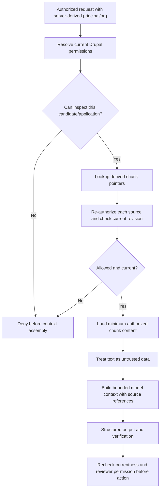

# Retrieval Authorization, Provenance and Freshness

**Document ID:** RAP-SEC-001  
**Version:** 0.1.0 / Proposed  
**Decision basis:** ADR-0002 / D-002; requirements FR-015, FR-024–027; NFR-013–014  
**Implementation:** Not built

## Trust boundaries

1. **Drupal authoritative:** identity, source records, revision/snapshot identifiers, current state, permissions, withdrawal, coordinator decisions.
2. **Authenticated source adapter:** trusted backend boundary to Drupal. The agent never receives arbitrary write access or service credentials.
3. **Derived RAG projection:** chunks/embeddings from permitted source material; potentially stale, never truth.
4. **External reasoning:** untrusted candidate text and LLM output stay separated from application instructions. Model output is a typed recommendation proposal.
5. **Review action:** re-check principal, source freshness, policy and recommendation verification **at commit time**.

## Derived retrieval manifest

`RetrievalChunk` stores `chunk_id`, organization, exact `SourceReference`, access scope, index version, a content pointer and content hash. The text pointer resolves to a **controlled derived store**, not to an unrestricted URL. Source revision, scope and content hash are preserved across indexing/retrieval.

`SourceReference` is the shared identity across direct structured reads, EvidenceRecord and RAG. `source_system=fixture` supports offline examples. `source_system=drupal` means adapter-managed references that must resolve to actual records/versions.

## Required authorization sequence

Do not rely on: metadata-filtering alone, the embedding model, agent prompts, chunk-provided permission labels, LangChain retriever defaults, or entity IDs supplied by the browser. Treat all as insufficient without authoritative checks.

## Change, revoke and delete behavior

| Event | Immediate serving behavior | Asynchronous cleanup |
|---|---|---|
| Source revision changes | Reject use of chunks for prior revision; queued suggestions become obsolete | Reindex permitted new revision |
| Candidate withdraws an application | Deny withdrawn application as active match evidence; block reviews relying on it | Remove or quarantine derived chunks/embeddings based on retention policy |
| Access is revoked | Fail closed before retrieval/prompt assembly, independent of index lag | Remove/rekey affected index entries |
| Opportunity becomes paused/closed | Deterministic policy gate blocks recommendation | Refresh source/retrieval projection |
| Policy changes | New run pins new policy version; review of old run requires revalidation | Retain policy lineage for reproducibility without broad prompt content retention |
| Source is deleted | Treat as unresolved/unavailable evidence; block use | Purge derived content according to documented privacy rules |

**Freshness is a predicate evaluated at retrieval and at review**, not a permanent field that an index can assert forever. Eventually consistent invalidation is acceptable only if serving is immediately safe by failing closed.

## Key threats and tests

| Threat | Guard | Negative fixture/test ID |
|---|---|---|
| Cross-organization reference | Request org equals source org AND principal authorization | PILOT-T004 / T013; `EVAL-G004`, `H002` |
| Unauthorized private content | Permission-check at source before any text enters model context | PILOT-T013; `EVAL-G007` |
| Stale vector/chunk after update | Revision comparison and invalidation | PILOT-T014; `EVAL-G006` |
| Unsupported candidate inference | Source-claim pairing and independent verification | PILOT-T005/T017; `EVAL-G005`, `H004` |
| Prompt injection in an application answer | Treat retrieved text as data only; tools/roles/policies not supplied by candidates | Add dedicated injection fixture before Slice 2 exit |
| Secrets and PII in LangFuse | Redacted/synthetic IDs only, privacy-conscious capture policy | PILOT-T018 |
| Stale recommendations presented as current | Check source/policy snapshot at human action | PILOT-T014 |
| Insecure review impersonation | Server-side Drupal principal identity + review permission | PILOT-T006/T007 integrated tests |

## Design/implementation choices still open

- Drupal Search API / Drupal AI solution vs external search index vs hybrid.
- Embeddings, tokenization, chunk size, refresh transport, source document format, caching.
- Permission-check mechanism for delegated backend calls; handling nested candidate/program scopes.
- Retention, legal basis, subject access/deletion, sensitive information minimization for live applicants.
- Performance/latency impact of per-source live permission checks; safe batching/cache design.

## Security acceptance for integrated pilot

All negative fixtures must fail closed before prompt exposure. Every cited snippet used in a reviewer decision must resolve to the authorized current Drupal revision. The index may lag; **authorization and currentness cannot**. Test with synthetic data only; a passing demonstration does not certify legal/safe production hiring use.