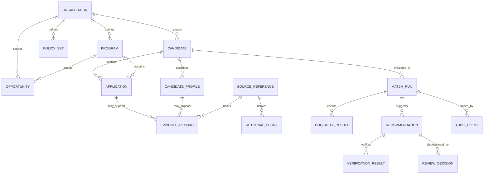

# Recruitment Augmentation Platform — Domain Model

**Document ID:** RAP-MODEL-001  
**Version:** 0.1.0 / Proposed for contract review  
**Date:** 2026-10-12  
**Authority:** D-001, D-002, D-003 in `docs/decisions/` and Foundation v0.3  
**Status:** A *draft implementation model*, not an additional accepted ADR

## Scope and terminology

The first pilot is nonprofit internship placement; the **core** models recruitment assistance without representing an internship as a special class. Organization and program policies are versioned and replaceable. The domain represents **recommendations for a person's review**, not hiring, program admission, or placement decisions.

Approved constraints from the foundation:

- Drupal is the **authoritative reference application** for the integrated pilot. The `fixture` adapter is only an offline test substitute.
- Retrieved text is a rebuildable, authorization-filtered **projection**, never business truth.
- Typed contracts, deterministic eligibility, human review, evidence lineage, and evaluation are first-class.
- No real candidates, resumes, credentials, or client-specific content in a public repo.

## Bounded contexts

| Context | Owns | Does not own |
|---|---|---|
| Identity and access | Authenticated Drupal `User`, reviewer permissions, organization/program scopes | Inferential matching |
| Recruiting records (Drupal) | `Candidate`, revisioned `CandidateProfile`, `Application`, `Opportunity`, `Program`, `PolicySet`, `ReviewDecision` | Model scores or embeddings as authority |
| Evidence and retrieval | `SourceReference`, `EvidenceRecord`, derived `RetrievalChunk`, currentness checks | Changing candidate statements |
| Match process | `MatchRun`, `EligibilityResult`, `Recommendation`, `VerificationResult` | Final employment/placement decision |
| Quality assurance | `EvaluationCase`, `EvaluationRun`, observed errors, version pins, promotion decision | Declaring synthetic labels equivalent to real hiring truth |
| Audit | `AuditEvent` and reviewer attribution | Publishing applicant text in traces |

## Identity / entity semantics

`User` is **a Drupal authenticated account**; it is never the universal `candidate_id`. A person may have an account and multiple context-specific applications. The MVP uses one synthetic account for each candidate but contracts do not assume one user = one application.

`Candidate` is the stable, organization-scoped recruitment subject ID. A profile is *versioned asserted information*; multiple profile versions must not change candidate identity. `Application` is a specific submission to a program or opportunity, with its own status, source revision, and scope. Explicitly preserve withdrawn applications for audit while disallowing them as active evidence.

`CandidateClaim` records a specific attribute with one of: `declared` (person/source says it), `inferred` (AI-derived proposal, **not** silently authoritative), `unknown` (no supported value), and `contested` (conflicting support). A claim's state is not an approval and does not imply accuracy. Skills/availability must not be invented from adjacent signals.

`Opportunity` is generalized: `opportunity_type` can be `internship`, `job`, `fellowship`, or a future category. Special rules are configurable in `PolicySet`, not hard-coded into the type.

## Relationships

The diagram is conceptual. An exact Drupal schema and the physical/foreign-key data model remain **unselected**.

## Core invariants

1. `organization_id` equality must be checked **across referenced objects**, not just inside each schema. A scoped principal must also be authenticated/authorized.
2. `SourceReference` identifies an authoritative entity and revision/version; downstream evidence and recommendations must be revalidated before use or reviewer action.
3. For an eligibility result: **any fail → `ineligible`; else any unknown → `needs_information`; otherwise `eligible`**. This is a *rule-engine result*, **not candidate rejection**.
4. A recommendation requires `eligible`, cites real authorized evidence, and can be marked `ready_for_review` only after verification.
5. Normal coordinator approval requires a verified recommendation with current sources and a real authenticated reviewer. `approve_for_follow_up` is not placement.
6. A `reviewer_id` field or client-supplied role by itself **does not prove authorization**. The application verifies it using Drupal identity/access controls.
7. `idempotency_key` is a request identity; transactional unique-write semantics must be implemented by the authoritative persistence layer.
8. `AuditEvent` data shape does **not** implement append-only storage. The storage/write path must enforce it.
9. `RetrievalChunk` cannot authorize itself: a live access check must precede exposing content to an AI context.
10. Negative eligibility and unknown outcomes must not silently feed an automated ranking/denial pipeline.

## Statuses / lifecycle

- Run: `created → validating → eligibility_checked → generating → verifying → awaiting_review → completed`, plus `information_required`, `failed`, `cancelled` branches. State transitions are proposed and must be ratified as a transition table.
- Opportunity: `active | paused | closed`.
- Application: `draft | submitted | withdrawn | closed`.
- Recommendation: `pending_verification | ready_for_review | needs_information | escalated | obsolete`.
- Review decision: `approve_for_follow_up | reject_suggestion | request_information`. *Reject suggestion* is not rejection of the candidate.

## Example portability

The same `Opportunity` class validates `opportunity_type="job"` or `"internship"`. The same `ReviewDecision` applies. A future employer could supply a job-specific policy set and ATS source adapter, but both are **future implementation work**, not proven by a schema-only test.

## Traceability

| Contract boundary | Requirement | Acceptance |
|---|---|---|
| Candidate, profile, application separation | FR-002, FR-022 | PILOT-T011 |
| Organization-scoped entities, references | FR-003, FR-018 | PILOT-T004, T013 |
| Opportunity portability | FR-017, FR-019, FR-021 | PILOT-T008 |
| Policy/rule identity, unknown behavior | FR-004, FR-020 | PILOT-T001, T002, T003, T010 |
| Recommendation/evidence/verification | FR-005, FR-006, FR-007 | PILOT-T005, T015 |
| Human disposition/idempotency | FR-009, FR-010, FR-013 | PILOT-T006, T007 |
| Source/retrieval integrity | FR-015, FR-024, FR-025 | PILOT-T012, T013, T014 |
| Evaluation | FR-012, FR-028, FR-029, FR-030 | PILOT-T016, T017 |

## Decisions still open

- Relationship and retention of a candidate ID across organizations; first pilot scopes each to one organization.
- Whether profiles are dedicated revisionable custom entities, Profile-module entities, or content entities; no Drupal bundle type is accepted yet.
- Handling joint program ownership and opportunities outside the nonprofit organization.
- Consent/notice, correction and deletion flows, legal/fairness review, production data classification and impact assessment before real applicants.
- Access to sensitive attributes: exclude from matching prompts and structured policy examples; review real-world requirements separately with qualified stakeholders.
- Whether candidate-derived facts ever become reviewed Drupal facts (would require a separate explicit staff/candidate correction workflow).