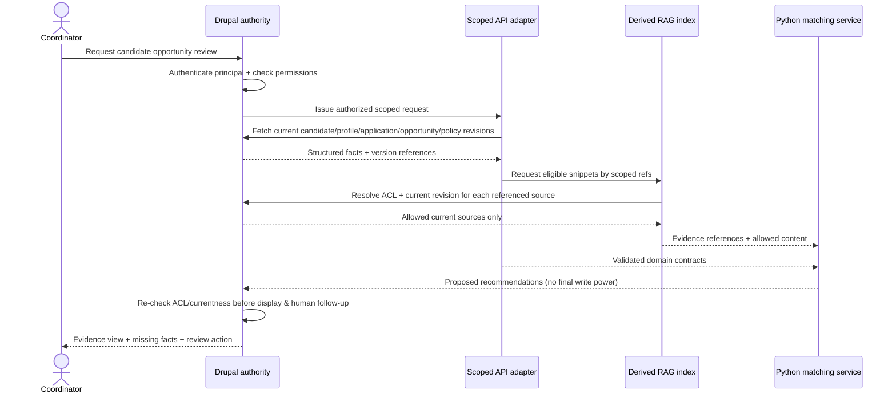

# Drupal ↔ Portable Recruitment Contracts — Mapping Specification

**Document ID:** RAP-MAP-001  
**Version:** 0.1.0 / Proposed  
**Decision basis:** ADR-0002 / D-002  
**Status:** Logical mapping, **not** a Drupal schema/module commitment

## What Drupal owns

For the integrated synthetic nonprofit pilot, Drupal owns authoritative user identities, candidate profile and application revisions, program and opportunity content, policy versions, staff review decisions and access-control rules. Python may cache **read-only snapshots** of permitted facts for work, but does not create or change an authoritative candidate claim by generating text.

## Logical mapping

| Drupal-side logical record | Proposed Drupal implementation options (OPEN) | Portable contract(s) | Authority and revision |
|---|---|---|---|
| User account | Drupal `user` entity | `Candidate.identity_source_ref` only, via adapter map | Account is identity, **not** candidate ID; may need a logical snapshot/version if entity is not revisionable |
| Candidate profile | Revisionable custom content entity or Profile-module entity | `CandidateProfile`, `CandidateClaim`, `EvidenceRecord` | Candidate-declared facts; source entity and specific revision |
| Submitted application | Revisionable custom entity or configured content type | `Application`, associated `EvidenceRecord` | Program/opportunity participation and submitted answers; revision + withdrawal state |
| Program | Content/config entity (to decide) | `Program` | Program name/terms; apply correct scope/version |
| Opportunity | Revisionable content entity | `Opportunity`, `EvidenceRecord` | Published tasks, qualifications, status, version |
| Policy set | Custom revisionable config/content artifact | `PolicySet`, `PolicyRule` | Versioned immutable snapshot used for a run |
| Coordinator decision | Restricted custom review entity/workflow | `ReviewDecision`, `AuditEvent` | Authenticated human action, timestamp, audit, idempotency |
| Derived retrieval record | Index backend selected later | `RetrievalChunk` | **Not** authoritative; resolver must access-check and revision-check source |

**Native Drupal implementation is undecided.** Not all Drupal entity classes are revisionable. `SourceReference.revision_id` represents the *version identifier required by the contract*: use a true Drupal revision ID where supported, otherwise a documented stable snapshot/content version token. Do not label a snapshot hash as a native Drupal revision.

## Stable identifiers and mapping table

Portable identifiers such as `candidate_demo_a` are independent of native Drupal entity IDs and UUIDs. The adapter should maintain mappings of:

```text
organization_id, portable_entity_type, portable_id
  -> source_system, source_entity_type, source_entity_id, source_revision_or_snapshot
```

Do **not** derive a `candidate_id` directly from an email, username, name, Drupal `uid`, or an LLM output. Do not assume an identity/account maps one-to-one to an application.

## Proposed read flow



*This is a proposed authorization sequence.* In production, use server-validated principal identity; do not trust user-supplied `organization_id`, signed roles, or client-side review flags. Service-to-service authentication still requires actor-scoped or equivalent enforceable delegated permissions.

## Pseudocode contract boundary

```python
# Not an implemented Drupal endpoint.
class RecruitmentAuthorityAdapter(Protocol):
    def fetch_authorized_snapshot(self, principal, org_id, application_id): ...
    def verify_current_and_allowed(self, principal, source_ref): ...
    def load_source_evidence(self, principal, source_ref): ...
    def record_human_review(self, principal, review_command, idempotency_key): ...
```

In the first offline Slice 0, fixture records replace Drupal. They are marked `source_system="fixture"`. The integrated Drupal slice must use `source_system="drupal"`, real entity IDs/revision or snapshot tokens and real permission behavior.

## Invalidation and review freshness

- On profile/application/opportunity/policy update, withdrawal, permission change or delete: enqueue invalidation of affected retrieval chunks and mark dependent queued recommendations `obsolete` (or require regeneration).
- **Fail closed immediately** on query or review even if index deletion/rebuild is still pending.
- Before `approve_for_follow_up`, compare all material `SourceReference`s and the policy version to current authorized Drupal state; a stale record cannot be silently accepted.
- Audit source revision, decision and reviewer identity; do not store full candidate text in telemetry.

## Identity, permissions and privacy tests

- A program coordinator may access only authorized candidate/program scopes.
- An unrelated role gets no retrieval content even if it can guess a `chunk_id`.
- A wrong-organization reference is denied before prompt construction.
- Changed or withdrawn candidate records are denied from stale snapshots/index content.
- A service account can submit a **proposal** but cannot impersonate a coordinator's `ReviewDecision`.

## Open design questions

1. Drupal version and exact module strategy: Drupal AI/AI Search, Search API, custom entities, Profile, etc.
2. Permission delegation between Drupal and Python: scoped request token, backend-for-frontend, or another secure pattern.
3. Source revisions for non-revisionable entities and index invalidation events.
4. How review records are kept append-only/idempotent under concurrency.
5. Retention/deletion/subject rights once real data is considered; demonstration stays synthetic.