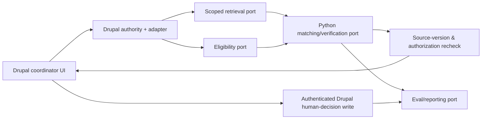

# Service and Workflow Boundaries — Contract-First Proposal

**Document ID:** RAP-API-001  
**Version:** 0.1.0 / Proposed  
**Decision basis:** D-001, D-002, D-003  
**Status:** Logical operations, not deployed endpoints, LangGraph nodes, or Temporal workflow definitions

## Boundary principle

The portable recruitment platform is not a generic chatbot. It has typed, authorized business operations; deterministic eligibility; an optional model-driven reasoning segment; and human-controlled actions. Model/tool libraries may compose these operations but **cannot set business permissions or employment outcomes**.

## Proposed application ports

| Port / operation | Caller input (after trusted authentication) | Output | Mandatory checks |
|---|---|---|---|
| `load_authorized_case` | Principal, organization ID, application ID | `Candidate`, current `CandidateProfile`, `Application`, relevant `Opportunity[]`, `PolicySet`, refs | Drupal permissions, current versions, same-organization |
| `resolve_evidence` | Principal, allowed `SourceReference[]`, query/context budget | Authorized evidence snippets + `EvidenceRecord[]`, versioned chunk IDs | ACL before content, source freshness, task-scope minimization |
| `evaluate_eligibility` | Snapshot, one opportunity, versioned policy | `EligibilityResult` | Pure deterministic rules, explicit unknowns |
| `propose_recommendation` | Eligible opportunity and authorized claims/evidence | `Recommendation` pending verification | Cannot see ineligible items or arbitrary source text |
| `verify_recommendation` | Proposed recommendation, evidence, eligibility, pinned versions | `VerificationResult` with issues | Schema + citation + policy + stale source + optional semantic verifier |
| `queue_review` | Valid verified suggestion | Reviewer-visible item in Drupal | Re-check source snapshots/permissions; no automatic business disposition |
| `record_human_review` | Authenticated reviewer, recommendation ID, action, reason, idempotency key | Immutable `ReviewDecision`, `AuditEvent` | Server-derived reviewer, scope, currentness, transactional unique write |
| `record_evaluation_observation` | Synthetic case ID, version pins, result, trace reference | `CaseObservation` / eventual `EvaluationRun` | Redact content; keep outcome vs detection distinction |

The `record_human_review` API must **not accept a caller-supplied trusted `reviewer_id`**. The service obtains that ID from the authenticated Drupal session/principal. The Pydantic `ReviewDecision` is the **persisted output contract**, not an authorization mechanism.

## Errors / fail-closed categories

| Code | Condition | Response |
|---|---|---|
| `AUTHORIZATION_DENIED` | Unauthorized/cross-org source or reviewer | Deny; never return protected text |
| `SOURCE_CHANGED` | Profile, application, opportunity or policy revision changed | Mark pending suggestion obsolete; re-run as required |
| `SOURCE_WITHDRAWN` | Applicant withdrew consent/application or source removed | Deny use and initiate derived-data purge according to policy |
| `DATA_VALIDATION_FAILED` | Pydantic/schema mismatch or missing required data | Quarantine; record minimal diagnostic; request information where appropriate |
| `ELIGIBILITY_NOT_SATISFIED` | At least one hard rule fails | No match proposal; do not automatically reject candidate |
| `ELIGIBILITY_UNKNOWN` | Required input is missing/contested | Request information; do not infer pass/fail |
| `EVIDENCE_UNSUPPORTED` | Cited claim cannot be supported | Bounded revision/escalation; no normal review approval |
| `INFERENCE_TRANSIENT_FAILURE` | Provider timeout/rate-limit | Bounded safe retry if applicable; inspect idempotency |
| `REVIEW_STALE` | User attempted review of obsolete snapshot | Reject action and refresh context |

## Inside and outside Drupal

The target technology *roles* remain consistent with the historical project: **LangChain** can supply retrieval and model adapters, **LangGraph** can execute bounded Profile/Placement/Verification reasoning, **Temporal** can own a long-running durable lifecycle, **Pydantic** supplies typed contracts, **LangFuse** can correlate traces/experiments. **None of those exact integration choices is ratified as a concrete implementation here**; this modeling phase defines the interfaces they must respect. Drupal AI or a custom Drupal UI may supply the staff-facing AI interaction.

## Workflow boundaries when orchestration is added

- A run is scoped to organization + application + pinned source/policy versions.
- Temporal workflow code should remain deterministic. Call to model-driven LangGraph service happens behind a retry-safe activity or equivalent external boundary, not replay-sensitive workflow logic.
- Changes in retrieved documents between activity attempts require source version/revalidation handling; do not silently accept a semantically different fresh source as the same operation.
- LangFuse traces never replace `AuditEvent` or authoritative Drupal review records. Trace correlation uses opaque IDs and minimal metadata.
- `MatchRun`/`Recommendation` state is *workflow data*, not a second candidate system of record.

## Contract tests to add during implementation

1. Caller cannot request foreign organization data with a spoofed `organization_id`.
2. Permission revocation between retrieval and human review blocks the review action.
3. Candidate profile revision change while Temporal is paused results in `SOURCE_CHANGED` instead of stale acceptance.
4. A mismatched policy version prevents a recommendation being marked `ready_for_review`.
5. Replaying a `record_human_review` command with identical idempotency key creates **one** authoritative decision, not two.
6. A model cannot invoke `record_human_review`; only a server-authenticated human may do so.
7. Cost/latency traces may link to a run without storing candidate documents.

## Next decisions

- Source adapter transport, authentication/delegation mechanism and contract error representations (HTTP vs RPC vs queues).
- Whether first offline review uses CLI fixtures or minimal UI.
- Exact service topology, model/provider selection and orchestrator boundaries.
- Promotion pipeline implementation and evaluation dataset governance.