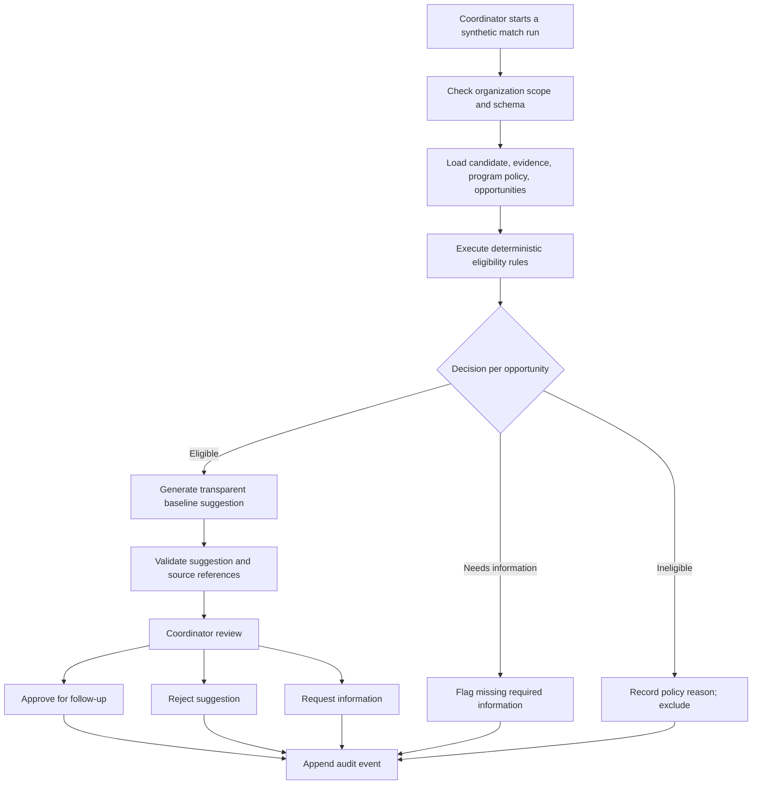

# Nonprofit Internship Placement — Pilot Specification

**Document ID:** RAP-PILOT-001  
**Version:** 0.2.0  
**Date:** 2026-10-12  
**Status:** Proposed pilot requirements; not yet accepted as build specification  
**Parent decisions:** ADR-0001 / D-001; ADR-0002 / D-002; ADR-0003 / D-003  
**Data:** Synthetic only  
**Technology stack:** Drupal authoritative application and secure derived RAG required for integrated pilot; backend/provider/framework details open  
**Primary reviewer:** Nonprofit program coordinator (proposed; confirm before contract freeze)

## 1. Purpose

Demonstrate a complete and inspectable **candidate-to-opportunity recommendation and review workflow** for a small nonprofit internship program. The implementation must exercise generalized Recruitment Augmentation Platform contracts, not introduce nonprofit-specific logic into the platform core. **The completed pilot must showcase AI inside and outside Drupal, authoritative Drupal records, secure revision-aware RAG, and measured evaluation/prompt change control.** An offline no-LLM baseline remains the initial slice, not the whole pilot.

This is an independent fictional demonstration inspired by an interview-described placement process. It is **not** a copy of a client production system.

## 2. Pilot outcome and boundary

A coordinator can select a synthetic applicant backed by a Drupal account, versioned candidate profile and application, view which active internships pass or fail explicit program rules, inspect source-grounded suggestions through an **in-Drupal evidence view**, and record an authorized **human disposition for follow-up**. An external Python service performs bounded matching/verification using permitted structured facts plus derived RAG context.

The pilot cannot create a binding internship offer, deny a candidate entry to a program, auto-reject an application, or trigger downstream HR actions.

## 3. User story

> As a nonprofit program coordinator, I want to review relevant internship opportunities for a candidate without manually comparing every application and position description, so I can identify reasonable follow-up options, understand the supporting evidence and unknowns, and record a review decision.

### Completion conditions

- A candidate and opportunity must belong to the selected organization context.
- Every relevant record must pass typed contract validation.
- Inactive opportunities do not advance.
- Missing information is recorded explicitly; it is not inferred into eligibility.
- Any AI recommendation must cite permissible evidence; invalid citations fail verification.
- A model cannot override policy rules or human review authority.
- A human records `approve_for_follow_up`, `reject_suggestion`, or `request_information`.
- Every decision links to recommendation, run, policy version, reviewer, and time.
- In the integrated pilot, candidate, application, opportunity, policy and human-review source data are authoritative in Drupal with entity/revision references; external projections never become facts automatically.
- Retrieved unstructured text is filtered by authorization and checked for source freshness before use; revoked or stale material is not valid evidence.
- Model/prompt/retrieval experiments are compared with versioned synthetic evaluation cases, including blocking safety regressions.

## 4. Synthetic organization and pilot configuration [PROPOSAL]

Use the following **fictional** configuration for the first dataset:

| Fixture | ID | Example |
|---|---|---|
| Organization | `org_demo_001` | Harbor Futures (fictional nonprofit) |
| Program | `program_demo_001` | Digital Pathways Internship Program |
| Reviewer | `reviewer_demo_001` | Program Coordinator |
| Active policy set | `policy_demo_v1` | Published program and opportunity eligibility checks |
| Candidate A | `candidate_demo_a` | Reports Python/data project experience; 20 available hours/week; program participation confirmed |
| Candidate B | `candidate_demo_b` | Reports web content interests; weekly availability missing; program participation confirmed |
| Opportunity 1 | `opportunity_demo_data` | Data Steward Internship — active; 12 hours/week; requires documented Python familiarity |
| Opportunity 2 | `opportunity_demo_web` | Web Content Internship — active; 10 hours/week; no specialized hard skill |
| Opportunity 3 | `opportunity_demo_ops` | Community Operations Internship — paused |

All names, examples, and attributes are invented solely for development/testing. Treat evidence as explicit synthetic fixture references rather than assumed candidate facts.

## 5. Pilot-specific policies [PROPOSAL]

Policies apply through a **general policy-engine interface**; each rule has ID, version, scope, inputs, and outcome.

| Rule | Deterministic input | Decision when unsatisfied | Notes |
|---|---|---|---|
| `PILOT-ACTIVE-001` | Opportunity status is `active` | `ineligible` | Paused/closed postings cannot be recommended |
| `PILOT-PROGRAM-002` | Candidate participation in the specific pilot program is confirmed | `needs_information` if unknown; `ineligible` if explicitly false | Program-specific, not a universal hiring requirement |
| `PILOT-AVAIL-003` | Candidate-declared weekly availability meets published required hours | `needs_information` if unknown; `ineligible` if below requirement | No model guesses availability |
| `PILOT-SKILL-004` | Source-backed evidence for an explicitly mandatory opportunity qualification | `needs_information` if missing/ambiguous; `ineligible` only if explicitly contradicted by reliable facts | No implicit skill inference or proxy demographic signals |

A result of `needs_information` is **not** a model-generated employment rejection. The rule set must be reviewed for fairness and legal appropriateness before real-world use.

## 6. Preliminary contract boundary

### Shared core types

`Organization`, `Candidate`, `Application`, `Program` (optional), `Opportunity`, `SourceReference`, `EvidenceRecord`, `PolicySet`, `EligibilityResult`, `MatchRun`, `Recommendation`, `VerificationResult`, `ReviewDecision`, `AuditEvent`, `EvaluationCase`, `EvaluationRun`.

`RetrievalChunk` is a **derived** projection tied to a current authoritative `SourceReference`; it is not a business record.

### Drupal source and API mapping [DECISION — D-002; exact entities proposed]

- Drupal `User` owns a synthetic candidate account; it is **not** the platform's universal `candidate_id`.
- Versioned Drupal candidate-profile data owns declared profile facts and source references.
- Drupal application records link profile participation to program/opportunity context.
- Drupal opportunities, policy data and coordinator review records are authoritative within the pilot.
- An authenticated adapter maps Drupal IDs/revisions into portable contracts; the model cannot write final placement/rejection or bypass an assigned coordinator.
- The derived RAG projection contains only permitted unstructured text with revision, organization/program scope, and evidence pointers. Changes/withdrawal invalidate old projections/recommendations.
- The source-side Drupal UI exposes evidence-backed AI assistance for staff; the agent workflows run through an external controlled Python service. Module, index and model provider choices remain **OPEN**.

### Pilot-only fixtures/configuration

`opportunity_type = internship`, `program_type = nonprofit_internship`, the four `PILOT-*` rules, synthetic applicants, internship descriptions, and review vocabulary.

### General-purpose portability check

Create one fictional `opportunity_type = job` fixture with an independent policy set. It must validate using **the same** `Opportunity`, `Candidate`, `EligibilityResult`, `Recommendation`, and `ReviewDecision` contracts. This is a test, not a second production workflow.

### Evaluation and prompt-promotion boundary [DECISION — D-003]

The pilot includes a versioned synthetic **golden regression set** and separate **held-out cases**. The comparison runner records fixture/policy/source/index/prompt/model/code versions, per-case expected vs observed outcomes, evidence support, violations, reviewer corrections, latency and token/cost metrics where available. A permissions leak, policy violation, stale-source use or critical unsupported claim blocks promotion regardless of average score. LangFuse is planned for trace and experiment correlation, not as a substitute for independent labels.

## 7. Logical first slice (no model calls)

No LLM or Drupal runtime is necessary to prove **Slice 0 only**. The **integrated pilot is not complete** until Drupal authority, revision-aware secure RAG, in-Drupal AI evidence review, external Python flow and evaluation promotion proof pass their later gates. The multi-agent design is compared with deterministic and single-model baselines rather than assumed to be better.

## 8. Initial acceptance-test inventory

| ID | Scenario | Expected outcome |
|---|---|---|
| `PILOT-T001` | Candidate A + active Data Steward opportunity, eligible facts documented | Eligible; evidence-backed baseline suggestion is reviewable |
| `PILOT-T002` | Candidate B with unknown weekly availability | `needs_information`; never invent availability |
| `PILOT-T003` | Paused Community Operations opportunity | `ineligible` with active-status rule reason |
| `PILOT-T004` | Candidate and opportunity have different `organization_id` | Fail closed; no recommendation |
| `PILOT-T005` | Recommendation cites nonexistent evidence | Verification fails; no normal review approval |
| `PILOT-T006` | Coordinator approves a suggestion for follow-up | One append-only review decision and audit event |
| `PILOT-T007` | Same review submission is retried | No duplicate logical decision or side effect |
| `PILOT-T008` | Fictional job opportunity is substituted for internship | Shared core contracts validate unchanged |
| `PILOT-T009` | Model verification fails repeatedly in a later AI slice | Bounded retry then human escalation; no endless loop |
| `PILOT-T010` | Candidate profile has conflicting qualification evidence | Preserve unknown/ambiguity; no silent promotion to fact |
| `PILOT-T011` | Synthetic candidate joins Drupal; profile/application revised | Adapter returns portable IDs plus correct source/revision references |
| `PILOT-T012` | Coordinator retrieves permitted application text through RAG | Each snippet cites current source ID/revision and applicable access scope |
| `PILOT-T013` | Unauthorized or cross-organization text retrieval attempted | Fail closed *before* content enters the AI prompt |
| `PILOT-T014` | Candidate withdraws/amends a document after indexing | Old chunk invalidated; previous recommendation cannot be accepted as current |
| `PILOT-T015` | In-Drupal reviewer opens generated candidate explanation | UI distinguishes authoritative, inferred and unknown claims with source links |
| `PILOT-T016` | A prompt/retrieval change is evaluated against golden + held-out data | Versioned per-case comparison documents changes, regressions, cost/latency if available |
| `PILOT-T017` | Candidate prompt produces unsupported critical claim or hard-eligibility violation | Promotion fails even if subjective quality improved |
| `PILOT-T018` | External agent run and Drupal reviewer decision complete | Source revisions, run/recommendation, evaluation and LangFuse trace IDs correlate without exposed applicant PII |

## 9. Evidence to retain

- Versioned synthetic fixture manifest, including evidence IDs.
- Eligibility results containing rule ID/version, input category, outcome, and reason.
- Recommendation contract examples with evidence pointers and explicit unknowns.
- Review and audit events with stable IDs, without production PII.
- A reproducible offline evaluation report including synthetic golden/held-out cases, per-case quality/safety regressions and promotion outcome.
- A Drupal source/revision mapping and allowed RAG chunk manifest with simulated invalidation results.
- An evidence-aware in-Drupal reviewer screen and privacy-safe external run/trace correlation demo for the integrated pilot.
- A short architecture diagram and executable test/CLI commands once implemented.

## 10. Definition of done for the pilot baseline and integrated release

- [ ] Clean checkout can execute Slice 0 without paid AI APIs.
- [ ] Generalized contracts contain no hardcoded internship-only domain class.
- [ ] Organization-scoping and cross-reference tests pass.
- [ ] All pilot eligibility rules have positive, negative, and unknown-state tests.
- [ ] At least one suggestion enters human review and receives an auditable disposition.
- [ ] Review retries do not duplicate the logical disposition.
- [ ] Portability contract test works with `opportunity_type=job`.
- [ ] README clearly marks the demo as synthetic, experimental, and not suitable for real hiring.
- [ ] No actual client, candidate, or proprietary data is in code, docs, tests, prompts, or traces.

**Additional integrated pilot completion criteria — required by D-002/D-003:**

- [ ] Synthetic records originate in Drupal with documented identity/profile/application/opportunity/policy/review mapping and source revisions.
- [ ] Authenticated source adapter and RAG deny forbidden contexts; allow only current, permission-filtered evidence.
- [ ] Source update/withdrawal tests block stale-index/citation use and demonstrate recovery.
- [ ] Coordinator reviews sourced/AI-inferred/unknown information **inside Drupal** and records follow-up disposition.
- [ ] External Python agent flow is demonstrated; model outputs remain typed, verified, bounded and cannot finalize a placement.
- [ ] Golden and held-out experiments produce versioned comparison reports and explicit safety-blocking prompt/retrieval/model promotion decisions.
- [ ] LangFuse trace/experiment integration maps to Drupal revision and recommendation IDs without real PII; Temporal workflow ID maps as appropriate after durability layer is implemented.
- [ ] Baselines and limitations are measured/documented; no unverified numerical improvement claims appear in the portfolio.

## 11. Next decisions

1. Confirm whether the first human reviewer should indeed be a nonprofit program coordinator.
2. Confirm that first-release approval means **follow-up only**, not a final placement.
3. Review the four sample policy rules and replace them with better fictional examples if needed.
4. Select the first execution surface: CLI or minimal web review UI.
5. Choose the Drupal in-product AI surface (Drupal AI ecosystem, bespoke reviewer UI or hybrid), authentication/adapter shape, and retrieval backend *after* contracts are reviewed.
6. Choose the language/tool versions, inference provider, Temporal/LangGraph/LLM integration depth, LangFuse topology, and spec-development framework after the next architecture model review.

## Change log

- **0.1.0 — 2026-10-12:** Initial fictional nonprofit internship pilot, core-vs-configuration boundary, versioned rule proposals, first-slice flow, and acceptance tests.
- **0.2.0 — 2026-10-12:** D-002 and D-003 adopted; source-of-truth Drupal mapping, derived secure RAG, in-Drupal AI review, synthetic evaluation and promotion gates, extended tests and integrated-pilot completion criteria.